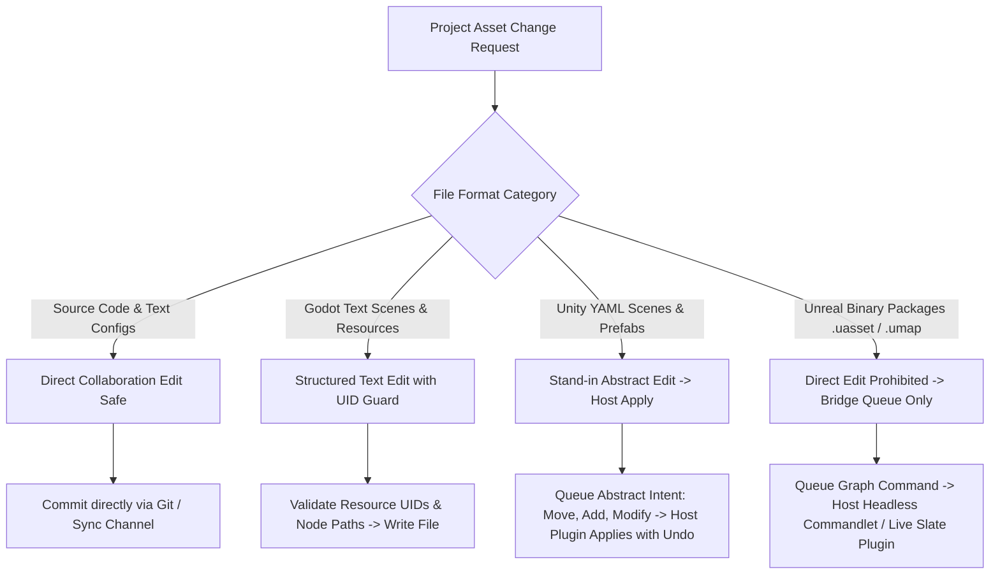
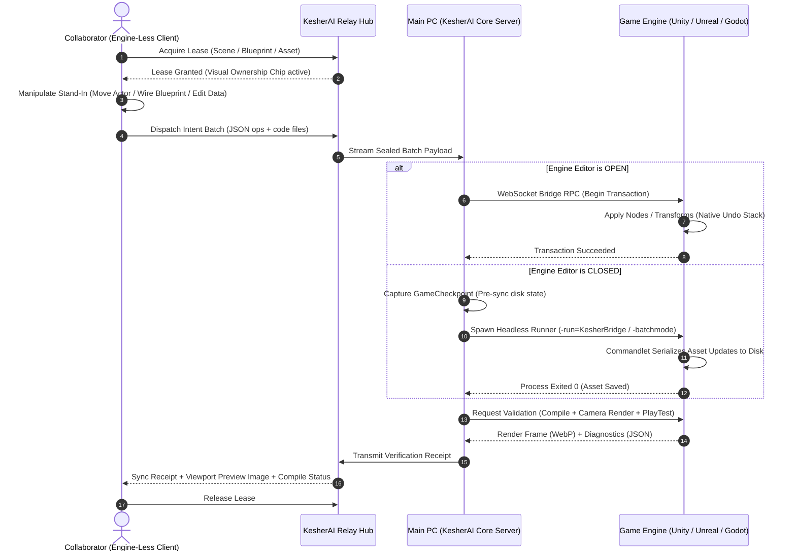
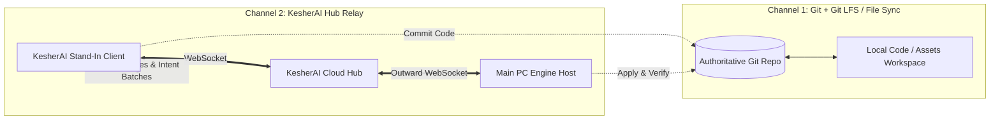
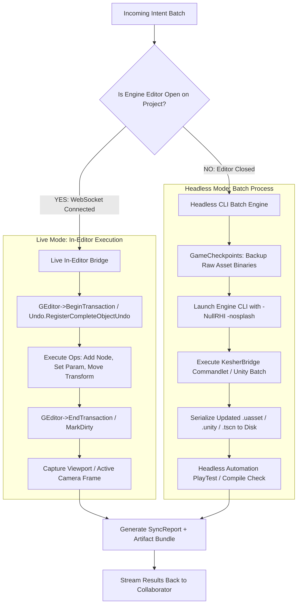
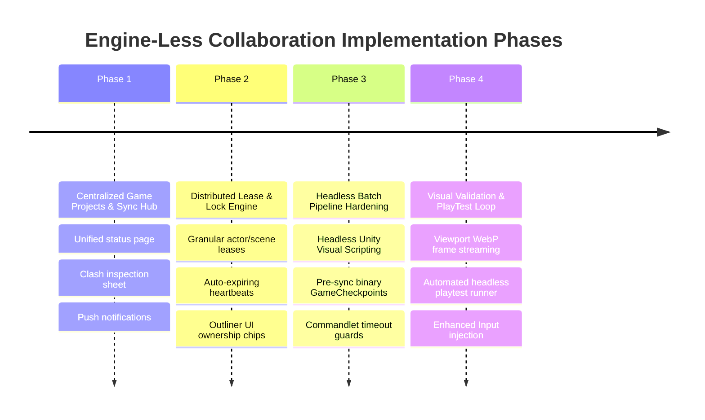

# Engine-Less Collaboration: Collaborator Workflows Without Game Engines and Central Host Application via KesherAI

## Executive Summary

Game development collaboration has historically mandated massive local installations: gigabytes of engine binaries (Unity, Unreal Engine, Godot), specialized version control thick clients (Perforce Helix Core, Plastic SCM), compiled code toolchains, and multi-gigabyte uncompressed asset caches. When non-technical collaborators (narrative designers, level dressers, translators, audio designers, or remote directors) need to tweak a dialogue variable, reposition props, adjust light intensities, or test gameplay balance, forcing them to install an 80+ GB engine setup creates severe friction and frequent repository breakage.

This deep research report establishes an end-to-end blueprint for **Engine-Less Collaboration** in KesherAI. Under this paradigm, only the primary workstation ("Main PC") hosts the game engines (Unity, Unreal, Godot), project SDKs, and KesherAI integration plugins. Collaborators require **zero local engine installations**. They inspect and edit the project using KesherAI's lightweight stand-in representations (browser/PWA/desktop scene outliners, 2D/3D stand-in viewports, visual scripting graph inspectors, and structured data tables). 

Changes made by collaborators are synchronized as intent-based semantic modification batches. The Main PC automatically receives these modifications and applies them to the authoritative project through KesherAI's engine plugins—invoking native Editor Transactions (preserving full Undo/Redo stacks) when the engine is actively open, or executing headless commandlet/batch pipelines when closed. The Main PC then computes diagnostics, captures viewport/camera validation renders, runs automated headless playtests, and streams verification artifacts back to the collaborators.

---

## 1. Deep Industry Benchmark: Collaboration, Light Clients, and Lock Mechanisms

To understand how KesherAI's engine-less architecture improves upon state-of-the-art workflows, eight industry paradigms were analyzed across five strict operational criteria:
1. **Client Prerequisites (What a collaborator must install):** Storage footprint and software dependencies.
2. **Locking & Concurrency:** How exclusive access and conflict avoidance are enforced.
3. **Transport & Data Movement:** Which files cross the wire and local workspace requirements.
4. **Project Landing Mechanism:** How external changes integrate into the authoritative engine state.
5. **Common Failure Modes:** What breaks under real-world multi-user stress.

### 1.1 Unity Version Control (Plastic SCM) & Gluon Artist Mode

* **Collaborator Installation:** Collaborators do not need the Unity Editor, but they must install the standalone **Gluon** desktop client (or Unity Version Control client) [1, 2].
* **Concurrency & Locking:** Gluon enforces an exclusive checkout model for binary assets [1]. When an artist modifies or selects "Checkout" on a file (e.g. `.fbx`, `.png`, `.prefab`), Gluon places an exclusive server-side lock [1]. Lock rules are defined per extension (e.g. `*.uasset`, `*.psd`) [3]. If another collaborator attempts to check out the same file, the server rejects the operation [1].
* **Files Moved:** Gluon operates on **partial workspaces** [1]. Collaborators do not clone the full repository; they select and download only the specific asset subtrees they require [1]. Text code and engine libraries can be excluded.
* **Landing Mechanism:** Changes are checked in directly to a shared branch [1]. Merging is minimized by enforcing single-branch workflows for artists [1].
* **What Breaks:** 
  1. *Ghost Locks and Lock Drift:* Network dropouts during check-in frequently leave orphaned locks (`.lck`) on the server, requiring manual administrative intervention via `cm unlock` [3, 4, 5].
  2. *Missing `.meta` Files:* If an artist adds an asset in Gluon without Unity open, no `.meta` file is generated. When the Unity developer later pulls, Unity generates a fresh random GUID, breaking all existing references [2].
  3. *Unresolved Scene Dependencies:* Gluon cannot validate whether modifying a prefab breaks nested prefab variants in unloaded scenes [1].

### 1.2 Perforce Helix Core + Unreal Multi-User Editing (Concert) & One File Per Actor (OFPA)

* **Collaborator Installation:** Traditionally requires both the full **Unreal Editor** installation (50–120 GB) and the **Perforce P4V** client [6, 7]. For pure Multi-User Editing, clients connect their local Unreal Editor instances over LAN/VPN to an `UnrealMultiUserServer` (Concert) [6].
* **Concurrency & Locking:** 
  - *Perforce:* Server-enforced exclusive checkout (`+l` filetype modifier) on binary `.uasset` and `.umap` files [7].
  - *Concert (Multi-User):* Operates at the live transactional level [6]. When a user selects or modifies an actor in the level viewport, Concert automatically acquires a live lock on that actor and broadcasts the transaction across connected editors [6, 8]. Other users see visual lock indicators (colored bounding boxes/avatars) and are blocked from saving changes to that actor [6, 8].
  - *OFPA (One File Per Actor):* Introduced in UE5 (standard in World Partition), OFPA extracts actors from the monolithic `.umap` package into individual external `.uasset` files located under `__ExternalActors__` [7]. This eliminates whole-map file locking: Designer A can check out `Actor_Light_01.uasset` while Designer B checks out `Actor_StaticMesh_42.uasset` without collision [7].
* **Files Moved:** In Concert, only small delta transaction payloads (property changes, transform vectors) move over UDP/TCP messaging during the session [6]. In Perforce, full binary `.uasset` files move upon checkout/submit [7].
* **Landing Mechanism:** In Concert, modifications live in a temporary session sandbox memory buffer [9, 10]. At session conclusion, the changes must be explicitly **persisted** (serialized to `.uasset` on disk) and submitted to Perforce [10, 11].
* **What Breaks:**
  1. *Thick Client Dependency:* Multi-User Editing fundamentally fails Roee's requirement because every participant must run a synchronized version of the Unreal Editor and compiled game binaries [6].
  2. *Transaction De-synchronization:* If a client drops packets or stalls during shader compilation, Concert session transactions can desynchronize, causing ghost transforms and memory state corruption [6, 9].
  3. *OFPA Folder Bloat:* Projects develop tens of thousands of miniature `.uasset` files in `__ExternalActors__`, drastically slowing down standard Git status scans and filesystem indexing [7].

### 1.3 Diversion (Cloud-Native Game VCS)

* **Collaborator Installation:** Collaborators can use a Web browser interface (`diversion.dev`), a native desktop app, or a lightweight CLI (`dv`) [12, 13].
* **Concurrency & Locking:** Provides a dual-tier locking architecture [14]:
  - *Soft Locks:* Non-blocking advisory visual indicators in the web and desktop UI, signaling that another user has opened or modified a file on another branch [14, 15].
  - *Hard Locks:* Server-enforced exclusive locks available on enterprise tiers [14]. Commits touching a hard-locked file by non-owners are rejected at the server level [14].
* **Files Moved:** Cloud-native architecture with virtualized storage; users download only what they touch, and the web interface allows browsing repository trees and binary asset previews (`.fbx`, `.glb`, `.uasset`) without downloading raw gigabyte-scale files [12, 16].
* **Landing Mechanism:** Commits land in cloud branches. Asset diffs are calculated in the cloud [14].
* **What Breaks:**
  1. *Read-Only Cloud Previews:* While Diversion allows viewing `.uasset` and 3D assets in the browser, **it cannot edit or author engine data from the web** [14, 16].
  2. *Web Client DOM Stalls:* Extremely large repository trees (100k+ assets) cause noticeable performance freezes when rendering lock states in the browser client [16].
  3. *No Engine Feedback:* Diversion cannot verify whether committed changes compile or crash the engine pipeline [14].

### 1.4 Anchorpoint (Git LFS Wrapper & Metadata Lock Server)

* **Collaborator Installation:** Requires the Anchorpoint desktop application [17, 18]. Engine installation is optional if the collaborator is merely pushing art assets, but required if opening the project [17, 19].
* **Concurrency & Locking:** Anchorpoint bypasses Git's lack of native real-time locking by running a **dedicated cloud metadata server** [17, 20]. When a user modifies a binary asset locally, Anchorpoint automatically sets an exclusive lock on the metadata server and toggles the local operating system file permissions to **read-only** for all other team members [17, 20]. When changes are pushed to Git LFS, the lock is automatically released [17, 20].
* **Files Moved:** Uses standard Git LFS under the hood, but supports sparse checkout and automated `.gitattributes` configuration to minimize bandwidth [17, 19].
* **Landing Mechanism:** Pushes standard Git commits and LFS pointer objects to GitHub, GitLab, or Azure DevOps [17, 18].
* **What Breaks:**
  1. *Metadata vs. Git Desync:* If a user commits via command-line Git or another GUI without Anchorpoint running, the metadata lock server is bypassed, resulting in silent binary overwrites [17, 21].
  2. *OS Attribute Tampering:* Because local lock enforcement relies on filesystem read-only bits, external tools or scripts that ignore or force-write file attributes break the locking guarantee [20, 22].
  3. *No Semantic Inspection:* Anchorpoint treats engine files as opaque binary blobs; it cannot inspect or modify actor hierarchies inside a `.umap` or `.unity` scene [17, 19].

### 1.5 Godot Text Scenes (.tscn / .tres) & Merge Drivers

* **Collaborator Installation:** Collaborators need only a basic text editor or Git client; Godot is not strictly required to read or edit text scenes [23, 24].
* **Concurrency & Locking:** Godot does not ship with built-in file locking [23]. It relies on standard Git distributed version control and optimistic concurrent editing [23, 24].
* **Files Moved:** Standard plain-text `.tscn` (scenes) and `.tres` (resources) move via standard Git fetch/push [23, 24].
* **Landing Mechanism:** Merges occur via standard Git 3-way text merge (`git merge`) or external community merge drivers like `tscnmerge` [23, 25].
* **What Breaks:**
  1. *UID Collisions:* In Godot 4, every resource and scene references unique IDs (`uid://...`) and external `.uid` sidecar files [26]. Independent branch creation generates conflicting UIDs that corrupt scene dependencies upon merge [26, 27].
  2. *Order-Dependent YAML/INI Parsing:* If two collaborators add child nodes to the same parent node, Git's line-by-line 3-way merge frequently interleaves properties, creating malformed syntax that crashes Godot's scene parser [23, 25].
  3. *ExtResource Index Shifting:* Adding an external resource increments local index counters (`[ext_resource type="..." id="2_abc"]`). Conflicting index shifts break property bindings throughout the scene body [23, 24].

### 1.6 Git LFS Locking (`git lfs lock`)

* **Collaborator Installation:** Collaborators need standard Git and the Git LFS command-line extension [22, 28].
* **Concurrency & Locking:** Enforces client-server locking via Git LFS API endpoints supported by GitHub, GitLab, and Gitea [22, 28]. Files matching `lockable` rules in `.gitattributes` are cloned with **read-only OS permissions** (`chmod a-w` or Windows read-only attribute) via `lfs.setlockablereadonly = true` [28, 29]. Executing `git lfs lock <file>` verifies lock availability with the remote server and flips the local file to read-write [28, 30].
* **Files Moved:** LFS pointer files move through Git; binary payloads are retrieved on-demand from the LFS storage server [22, 28].
* **Landing Mechanism:** Changes are committed as new LFS object hashes and pushed to the remote branch [22, 28]. Pre-push hooks verify lock ownership [22, 29].
* **What Breaks:**
  1. *Advisory Nature:* Lock enforcement is fundamentally advisory; any collaborator can run `attrib -r` on Windows or `chmod +w` on POSIX, edit the file, and commit locally [22].
  2. *Branch Agnosticism:* Standard Git LFS locks are repository-wide, not branch-specific. A lock on `feature-branch` blocks work on `main` [22, 28].
  3. *Latency:* Locking requires synchronous HTTP round-trips to the remote Git server, introducing friction during rapid scene prototyping [28, 30].

### 1.7 Unity Scene Merge (`UnityYAMLMerge`)

* **Collaborator Installation:** Requires the executable `UnityYAMLMerge.exe`, which is bundled exclusively inside the Unity Editor installation (`Editor/Data/Tools/UnityYAMLMerge.exe`) [31, 32]. Collaborators cannot run it without having the Unity Editor installed [31, 33].
* **Concurrency & Locking:** Designed as an optimistic 3-way semantic merge tool configured in `.gitconfig` as a `mergetool` [31, 32].
* **Files Moved:** Text YAML `.unity` and `.prefab` files move via Git [31, 33].
* **Landing Mechanism:** Git invokes `UnityYAMLMerge merge -p "$BASE" "$REMOTE" "$LOCAL" "$MERGED"` [31, 33]. The tool parses Unity YAML objects, matches GameObjects by their persistent `FileID`, merges non-overlapping component properties, and outputs a resolved scene [31, 32]. If an unresolvable semantic conflict occurs, it falls back to a configured 3rd-party merge tool (Beyond Compare, P4Merge) via `mergespecfile.txt` [31, 33].
* **What Breaks:**
  1. *Host-Only Binary:* Collaborators without Unity cannot run `UnityYAMLMerge` [31, 33].
  2. *FileID Collisions:* If two collaborators create new GameObjects independently, both instances may receive identical temporary FileIDs, resulting in duplicated or overwritten hierarchy entries upon merge [31, 32].
  3. *Prefab Override Corruption:* Complex nested prefab overrides (`m_Modification`) merged at text level frequently lose transform anchors or silently detach from parent prefabs [31, 33].

### 1.8 Cloud-Editor Tools & Lightweight Remote Systems

* **Bezi (bezi.com):** A browser-based collaborative 3D spatial prototyping and game development workspace [34, 35]. Collaborators require zero installation (Web browser only) [34, 36]. Users collaboratively manipulate 3D scenes, grey-box levels, and review prototypes in real time [34, 36]. However, to land in Unity/Unreal, it relies on in-engine AI integration plugins that import layouts into the engine [35, 37].
* **Coplay / Aura (coplay.dev / tryaura.dev):** Cross-engine AI assistant architectures for Unity and Unreal Engine [38, 39]. Rather than replacing the engine with a web client, they connect external AI agents (like Claude Code, Cursor, or KesherAI) directly to active engine sessions via local Model Context Protocol (MCP) servers and WebSocket bridges [39, 40].
* **PlayCanvas:** A fully cloud-hosted WebGL2/WebGPU game engine [41, 42]. Full real-time multi-user editing in the browser with presence avatars, camera frustum visualization, and instant web builds [41, 43]. However, it is an independent engine ecosystem; it cannot author native Unity or Unreal Engine projects [41, 42].
* **Unreal Engine Remote Control Web Interface:** Built-in Unreal Engine plugin that serves a Node.js companion web application over WebSockets/REST [44, 45]. External users on tablets or browsers can tweak exposed parameters, trigger Blueprint functions, and manipulate actor transforms in real time [44, 45]. However, the Unreal Editor must be running continuously on the host PC [44, 45].

---

### Comparative Evaluation Matrix

| System | Client Install Footprint | Locking Model | Files Moved Over Network | Engine Presence on Client | Major Failure Point |
| :--- | :--- | :--- | :--- | :--- | :--- |
| **Plastic SCM (Gluon)** | Desktop App (~150 MB) | Exclusive Server Lock | Partial workspace assets | Not required | Ghost locks; missing `.meta` GUIDs [1, 2, 4]. |
| **Perforce + Concert + OFPA** | Full Engine (50–120 GB) + P4V | Live Transactional + Exclusive | Delta transactions (UDP) + binary .uasset | **Mandatory** | Client desync; massive client storage footprint [6, 7]. |
| **Diversion** | Web Browser or CLI | Soft visual + Hard server lock | Virtualized sparse file tree | Not required | Cannot author engine data from web [14, 16]. |
| **Anchorpoint** | Desktop App (~300 MB) | Cloud Metadata Lock + Read-only OS | Git LFS binary files | Optional | Bypassed if using CLI Git; no semantic awareness [17, 20]. |
| **Godot Text Merge** | Plain text editor / Git | None (Optimistic concurrent) | Full `.tscn` / `.tres` text | Optional | UID collisions; broken node reference indexes [23, 26]. |
| **Git LFS Lock** | Git + Git LFS CLI | Server Lock + Local Read-only | LFS pointer deltas | Not required | Advisory OS locks; repo-wide lock scope [22, 28]. |
| **UnityYAMLMerge** | Full Unity Editor install | None (3-way semantic merge) | Full `.unity` / `.prefab` text | **Mandatory** | Cannot run standalone; breaks nested prefab overrides [31, 33]. |
| **Cloud (Bezi / PlayCanvas)** | Modern Web Browser (0 MB) | Real-time Operational Transform | JSON state deltas | Not required | Not a native Unity/Unreal authoring tool [34, 41]. |
| **KesherAI Stand-In (Proposed)**| **Zero Engine (Browser/PWA/Desktop)**| **Hub Lease + Semantic 3-Way Clash**| **Intent batches (JSON) + Code/YAML**| **Zero on Client (Main PC Only)**| Network partition during live WebSocket transaction. |

---

## 2. Engine File Format Safety: What Can and Cannot Be Edited Without the Engine

Understanding which files can be safely manipulated offline versus which require native engine serialization is the foundation of KesherAI's architecture.



### 2.1 Unity Engine File Formats

When Unity's Asset Serialization is set to "Force Text" (standard across modern version control projects), assets are serialized in a proprietary YAML dialect:

* **C# Scripts (`.cs`), Shaders (`.shader`, `.hlsl`), and UI Toolkit (`.uxml`, `.uss`):**
  - **Verdict:** **100% Safe for Direct Engine-Less Editing.**
  - **Mechanisms:** Pure text files. Collaborators can modify logic, algorithms, and styling freely. Unity compiles them automatically upon editor focus or via headless CLI batch mode (`-executeMethod`).
* **Unity Scenes (`.unity`) and Prefabs (`.prefab`):**
  - **Verdict:** **Unsafe for Direct Text Editing; Safe via KesherAI Stand-In Intent Queues.**
  - **Mechanisms:** Unity YAML files use unique document headers formatted as `--- !u!{ClassID} &{FileID}` (e.g. `!u!1` is a GameObject, `!u!4` is a Transform, `!u!20` is a Camera) [31, 32]. 
  - *Why Direct Editing Breaks:* 
    1. *FileID Generation:* Whenever a new GameObject or Component is created, Unity assigns a persistent 64-bit integer FileID. If a text editor generates arbitrary FileIDs, internal pointers break or collide.
    2. *Prefab Overrides (`m_Modification`):* Placed prefabs do not replicate the prefab's internal YAML; they serialize an override list specifying parent transform anchors, modified property paths, and removed components [31]. Manual text edits easily corrupt this override list, resulting in missing GameObjects or broken hierarchies.
* **ScriptableObjects (`.asset`) and Materials (`.mat`):**
  - **Verdict:** **Conditionally Safe for Primitive Value Editing.**
  - **Mechanisms:** ScriptableObjects reference their driving C# script via `m_Script: {fileID: 11500000, guid: <csharp_meta_guid>, type: 3}`. Modifying scalar values (integers, floats, strings, colors) is safe if field names match the C# class definition. Modifying polymorphic arrays or adding references to other assets is unsafe without engine validation.
* **Meta Files (`.meta`):**
  - **Verdict:** **Critical Dependency; Must Be Managed Automatically.**
  - **Mechanisms:** Every Unity asset requires an adjacent `.meta` file containing a 128-bit hex GUID and importer settings. If a collaborator adds a `.png` or `.cs` file without generating an identical `.meta` file, the Main PC's Unity instance will generate a random GUID upon import, permanently breaking all references pointing to that asset.

### 2.2 Unreal Engine File Formats

* **Source Code (`.cpp`, `.h`, `.cs`), Build Rules, and Configs (`.ini`):**
  - **Verdict:** **100% Safe for Direct Engine-Less Editing.**
  - **Mechanisms:** Standard text files. Collaborators can add gameplay components, C++ classes, and modify engine configuration settings (`DefaultEngine.ini`, `DefaultGame.ini`).
* **Unreal Levels (`.umap`) and Assets (`.uasset`):**
  - **Verdict:** **Strictly Prohibited from Direct Offline Editing.**
  - **Mechanisms:** Unreal packages use an optimized, complex binary format (`FPackageFileSummary`) consisting of name tables, import maps, export maps, pre-computed dependency graphs, and serialized bulk data [7]. In UE5, packages interact with the Zen Loader and IoStore chunk architectures [7].
  - *Why Direct Editing Destroys Packages:* 
    1. *Compiled Reflection Dependency:* Serializing a `.uasset` requires running Unreal's native C++ reflection system (`UProperty`/`FProperty` serialization). Without the engine runtime, the exact byte alignment and struct packing cannot be determined.
    2. *Binary Corruption:* Modifying a single byte in an actor's transform invalidates package header offsets, causing immediate `Package Corrupt` crashes upon load.
    3. *One File Per Actor (`__ExternalActors__`):* Although OFPA isolates actors into distinct files, **each external actor is still a full binary `.uasset` package** [7]. 
  - *The Solution:* Collaborators edit Unreal Blueprints and levels through KesherAI's abstract visual representations. Edits are recorded as high-level commands (`add_node`, `connect_pins`, `set_transform`, `delete_actor`) and submitted to the Main PC, which applies them natively through the KesherAI Unreal Bridge plugin or headless commandlet.

### 2.3 Godot Engine File Formats

* **GDScript (`.gd`), C# (`.cs`), and Project Settings (`project.godot`):**
  - **Verdict:** **100% Safe for Direct Engine-Less Editing.**
* **Godot Text Scenes (`.tscn`) and Text Resources (`.tres`):**
  - **Verdict:** **Safe for Structured Engine-Less Editing with AST Parsing.**
  - **Mechanisms:** Godot was intentionally designed with an INI-like human-readable text syntax [23, 24]. A scene file consists of declarative headers:
    ```ini
    [gd_scene load_steps=3 format=3 uid="uid://c8y2q8x1j8a0"]
    [ext_resource type="Texture2D" path="res://icon.svg" id="1_icon"]
    [node name="Player" type="CharacterBody2D"]
    position = Vector2(100, 250)
    ```
  - *Safety Considerations:* KesherAI's stand-in can directly read and write `.tscn` files without Godot running, provided that:
    1. Resource UIDs (`uid://...`) are preserved and verified [26].
    2. Node path hierarchies (`"Player/Arm/Hand"`) are maintained consistently across renames [23].
    3. Structural AST parsing is used rather than line-by-line regex to prevent syntax corruption [23, 25].

---

## 3. Recommended Architecture for KesherAI Engine-Less Collaboration

To achieve Roee's goal of allowing collaborators to build games without installing game engines, KesherAI must implement a **Distributed Host-Stand-In Architecture**. The Main PC acts as the authoritative **Engine Host**, while collaborators connect via lightweight **Stand-In Clients**.



### 3.1 Host-Client Topology

1. **The Main PC (Authoritative Engine Host):**
   - Hosts the installed engines (Unity 6 / UE 5.x / Godot 4.x), source compilers (Visual Studio / MSBuild / Clang), and the authoritative Git repository.
   - Runs `kesher-core` server with engine-specific integration bridges:
     - **Unreal:** `KesherAI Bridge Plugin` (WebSocket RPC server in-editor; `KesherBridgeCommandlet` headless) [46].
     - **Unity:** `KesherAI Unity Package` (EditorWindow & WebSocket bridge in-editor; `UnityCli` batch runner headless) [46, 47].
     - **Godot:** `Kesher Bridge GDExtension / Addon` (live WebSocket RPC in-editor; headless script execution headless) [48].
   - Executes validation tasks: headless compilation, camera snapshot rendering, and automated gameplay verification (`PlayTest`).
2. **The Collaborator Client (Engine-Less Stand-In):**
   - Runs KesherAI Desktop, Web PWA, or Phone UI (390 px responsive).
   - Contains **zero engine binaries**.
   - Interfaces:
     - *Stand-In Scene Outliner & 3D/2D Viewport:* Renders scene hierarchies, meshes, sprites, lights, and tilemaps using Three.js/WebGL from cached project geometry and textures [47].
     - *Visual Scripting Canvas:* Renders Unreal Blueprints and Unity Visual Scripting graphs with full zoom/pan, minimap, wire creation, and context-sensitive menus [46, 49].
     - *Code & Data Editor:* Monaco/CodeMirror editor for C#, C++, GDScript, shader files, and structured inspector tables for ScriptableObjects and data tables.

### 3.2 Synchronization Channel: Git Baseline + KesherAI Hub Relay

Sources frequently disagree on whether game collaboration should rely exclusively on Git or live WebSocket relays. Git excels at asynchronous baseline code versioning, branch management, and LFS asset tracking, but fails catastrophically at real-time locking, transient transform streaming, and headless command dispatch. 

**Recommended Hybrid Dual-Channel Architecture:**



1. **Channel 1: Git Baseline (Coarse Storage & Source Code):**
   - Used for text source code (`.cs`, `.cpp`, `.h`, `.gd`), documentation, shaders, and raw imported source art (`.png`, `.fbx`, `.wav`) tracked via Git LFS.
   - Collaborators can push code directly or submit pull requests.
2. **Channel 2: KesherAI Hub Relay (Fine-Grained Intents & Engine Dispatch):**
   - Used for all scene manipulations, Blueprint wiring, inspector property changes, file locks, and remote execution requests.
   - Operates over KesherAI's existing encrypted WebSocket hub client architecture (`hub-client.ts`) [50]. The Main PC maintains one outward persistent WebSocket connection to the Hub [50]. Collaborators stream lightweight JSON **Intent Batches** to the Hub, which forwards them directly to the Main PC [46, 50].
   - **Zero Firewall / Port Forwarding Friction:** Because the Main PC initiates an outward connection to the Hub, collaborators can work anywhere over the internet without configuring LAN VPNs or router port-forwarding [50].

### 3.3 Distributed Lock and Lease Protocol

To prevent destructive concurrent edits without forcing rigid Perforce-style checkouts, KesherAI implements a **Granular Lease Protocol**:

* **Granular Lock Targets:** Locks are acquired at the semantic level rather than the filesystem level:
  - *Unity:* Scene level (`Assets/Scenes/Main.unity`) or root Prefab level (`Assets/Prefabs/Player.prefab`).
  - *Unreal:* Level actor level (`MyLevel:Actor_Light_01` mapped to its OFPA file) or Blueprint asset level (`/Game/Blueprints/BP_Player`).
  - *Godot:* Scene node sub-branch (`Main/Level/Enemies`) or `.tscn` file.
* **Lease Mechanics:**
  - *Acquisition:* When a collaborator selects an actor or opens a Blueprint in the stand-in, the client requests a lease from the Main PC via the Hub.
  - *Heartbeat & Expiration:* Leases expire automatically after 5 minutes of inactivity unless refreshed by client interaction heartbeats. This permanently eliminates the "ghost lock" plague of Plastic SCM and Perforce [1, 4].
  - *Visual Ownership Chips:* Active leases broadcast collaborator identity to all connected clients. In the stand-in outliner, locked actors display a colored badge with the collaborator's avatar (e.g., `🔒 Rotated by Sarah`). Other collaborators can view the object but cannot modify properties until released.

### 3.4 Conflict Handling and 3-Way Semantic Clash Resolution

When a collaborator prepares to dispatch an intent batch for an asset that was modified locally on the Main PC (or inside the engine) during the lease window, KesherAI utilizes its proven **3-Way Clash Engine** (`game-sync.ts`) [46]:

* **Node Signatures (`nodeSig`):** When a collaborator loads a graph or scene stand-in, KesherAI captures a lightweight signature mapping node IDs to titles/hashes [46]:
  ```typescript
  // packages/core/src/game-sync.ts
  export function nodeSig(graph: BlueprintJson | undefined): Record<string, string>;
  ```
* **Structural Diffing (`graphDiff`):** Before applying a queued batch, the Main PC compares the base signature against the engine's current state, identifying nodes added, deleted, or modified on the host [46].
* **No Blind Overwrites (Roee's Rule):** If an asset's modification timestamp on the Main PC exceeds the collaborator's base capture by more than `SLACK_MS` (2000 ms), KesherAI halts the sync and presents the **Sync and Conflicts Sheet** [46]:
  - `mine`: Overwrites the host asset with the collaborator's queued intent operations.
  - `engine`: Discards the collaborator's queue and pulls the host engine's updated state.
  - `skip`: Pauses the batch for manual inspection, preserving the collaborator's queue in local storage [46].

### 3.5 Host Application Pipeline: Dual-Mode Execution (Live vs. Headless)

When an intent batch reaches the Main PC, `kesher-core` routes execution based on the engine's running status:



#### Mode A: Live In-Editor Bridge (Editor is Open)
1. **Communication:** `kesher-core` communicates over an authenticated local WebSocket to the engine plugin (`UnrealBridge` on port 8000, Unity EditorWindow relay, or Godot Bridge) [46, 48].
2. **Native Transactional Undo:** Every applied operation is enclosed within the engine's native undo system:
   - *Unreal:* Wrapped in an `FScopedTransaction Transaction(TEXT("KesherAI Remote Edit"));`, registering every modified `UObject` via `Modify()` [46]. The host developer can press `Ctrl+Z` directly in Unreal to undo the collaborator's remote edits step-by-step.
   - *Unity:* Registered via `Undo.RegisterCompleteObjectUndo(targetObject, "KesherAI Remote Edit")`.
   - *Godot:* Registered via `EditorUndoRedoManager`.
3. **Zero Asset Reload Friction:** Because operations execute inside editor memory, changes appear immediately in the host developer's viewport without triggering asset re-import cycles or asset reload dialogs [46].

#### Mode B: Headless Commandlet / Batch Execution (Editor is Closed)
1. **Pre-Sync Checkpointing:** To guarantee 100% rollback capability, `game-checkpoints.ts` creates a fast binary snapshot of all targeted asset files before execution begins [46, 51]:
   ```typescript
   await gameCheckpoints.capture({
     engine: b.engine, project: b.project, name: b.name, source: "sync",
     label: `Sync: ${b.count} change(s)`
   }, b.files);
   ```
2. **Execution Pipelines:**
   - *Unreal Engine:* `kesher-core` writes commands to `bridge-request.json` and launches `UnrealEditor-Cmd.exe` with low CPU priority [46]:
     ```bash
     UnrealEditor-Cmd.exe "<ProjectPath>.uproject" -run=KesherBridge -unattended -nop4 -nosplash -NullRHI -stdout
     ```
     The plugin's C++ `KesherBridgeCommandlet` initializes package contexts, executes the AST/graph mutations, calls `SavePackage()`, and writes execution results to `bridge-response.json` [46].
   - *Unity Engine:* `kesher-core` executes `Unity.exe` in headless batch mode [46]:
     ```bash
     Unity.exe -batchmode -nographics -projectPath "<ProjectPath>" -executeMethod KesherAI.Editor.CliBatch.Apply -quit -logFile "<LogPath>"
     ```
   - *Godot Engine:* `kesher-core` runs Godot in headless mode [48]:
     ```bash
     godot --headless --path "<ProjectPath>" --script res://addons/kesher_bridge/apply_batch.gd
     ```
3. **Safety Guard Against Double-Open:** If the engine editor process is open on the host without the KesherAI plugin connected, headless execution is strictly aborted to prevent two independent processes from writing to the same binary package and corrupting asset memory [46].

### 3.6 Remote Verification and Reporting Back to Collaborators

The final pillar of engine-less collaboration is closing the feedback loop. Collaborators cannot evaluate their work without seeing visual and diagnostic results:

1. **Visual Validation (Viewport & Camera Streaming):**
   - *Live Mode:* The host plugin triggers an off-screen viewport capture (`FSlateApplication::TakeScreenshot` or Unity `Camera.Render` to a `RenderTexture`). The frame is encoded as a WebP image and transmitted to the collaborator's chat/stand-in interface [47, 52].
   - *Headless Mode:* In Godot or Unity (with software rasterizer or Vulkan headless), camera nodes render validation stills of repositioned props.
2. **Diagnostic Compilation Parsing:**
   - When C# or C++ code changes are applied, the Main PC executes `Build.bat` or `dotnet build` and runs output through KesherAI's diagnostic parser (`parseCodeErrors.ts`) [46]. Errors are mapped directly to file paths, line numbers, and character spans on the collaborator's CodeMirror editor.
3. **Automated Headless Playtesting:**
   - Collaborators can dispatch functional gameplay test recipes [53]. On the Main PC, Unreal executes `Automation RunTests KesherAI.PlayTest.Request; Quit` via `-NullRHI` [46, 53]. Input actions are injected programmatically frame-by-frame via `IEnhancedInputSubsystemInterface::InjectInputForAction` [53]. Test assertion results, execution logs, and performance metrics are returned in the sync receipt [46, 53].
4. **Phone Notifications & Receipts:**
   - Finished sync operations produce a structured `SyncReport` card [46]. If a batch succeeds cleanly, a subtle receipt card renders in the conversation. If a compile error or asset clash occurs, a high-priority notification pushes to Roee's phone via KesherAI's phone push service [46, 54].

---

## 4. Synthesis and Comparative Analysis: Where Sources Agree and Disagree

### 4.1 Points of Consensus Across All Sources
1. **Binary Files Cannot Be Auto-Merged:** Every studied platform (Epic Games, Unity, Perforce, Anchorpoint, Diversion) agrees that standard 3-way text merging cannot resolve conflicts in binary `.uasset`, `.umap`, `.fbx`, or texture files [1, 6, 17, 22]. Exclusive locking or structural operational transformations are mandatory.
2. **Engine Dependencies Stifle Collaboration:** Forcing non-technical collaborators to maintain local engine installations and compile environments introduces massive overhead, recurring environment desynchronization, and version mismatch errors [1, 14, 34].
3. **Transactions Must Be Monitored by Undo Stacks:** Live editor modifications injected via network bridges must integrate with the host engine's native Undo/Transaction system [6, 40]. Bypassing the undo stack risks leaving editor scene graphs in corrupted, unrecoverable memory states.

### 4.2 Critical Architectural Disagreements in the Field
1. **Git vs. Dedicated Metadata Servers for Locking:**
   - *Git LFS Advocates (GitHub, GitLab):* Argue that locking should be standardized within Git via `.gitattributes` and LFS API lock endpoints [22, 28].
   - *Anchorpoint & Diversion:* Strongly counter that Git LFS locking is too slow, brittle, and repository-wide; they argue that locking must be managed via dedicated real-time cloud metadata servers that decouple file locks from Git commit history [14, 17].
   - *Resolution for KesherAI:* KesherAI aligns with the metadata server philosophy: leases are handled dynamically via the KesherAI Hub WebSocket relay, eliminating Git LFS locking overhead and enabling sub-file (actor/node-level) lock granularity [46, 50].
2. **Direct YAML Editing vs. Plugin Application:**
   - *Open Source Tools (tscnmerge, UnityYAMLMerge):* Advocate for direct text parsing and external semantic 3-way merging of YAML/INI scene files [23, 31].
   - *KesherAI Core Engineering:* Disagrees with direct YAML text writing for Unity scenes. Production evidence shows that manual YAML generation breaks internal FileID allocation, corrupts complex prefab overrides (`m_Modification`), and fails on custom serialized components [47]. Applying changes through host engine plugins (via native C# or C++ APIs) is vastly safer and preserves engine invariants [46, 47].

---

## 5. Implementation Roadmap for KesherAI

To transition this research into production code within KesherAI, the following prioritized execution phases are established:



1. **Phase 1: Centralized Game Projects & Sync Hub (Immediate Priority):**
   - Implement the unified Game Projects home page displaying project states across Unity, Unreal, and Godot (`open`, `closed`, `pending changes`, `last sync`, `conflicts`) [46].
   - Deploy the mobile-optimized (390 px) Sync and Conflicts sheet with granular `mine`, `engine`, and `skip` options [46].
2. **Phase 2: Distributed Lease & Lock Protocol:**
   - Extend `hub-client.ts` to manage semantic lease tokens for scenes, levels, and Blueprints [50].
   - Introduce lease expiration timers (5-minute heartbeat) and outliner ownership chips (`🔒 Locked by <Name>`) [46].
3. **Phase 3: Headless Batch Pipeline Hardening:**
   - Expand `unity-cli.ts` to support cached offline Visual Scripting graphs and queued background batch applications matching Unreal's headless bridge [46].
   - Integrate mandatory `GameCheckpoints` capture before executing any headless sync batch [46, 51].
4. **Phase 4: Remote Visual Feedback & PlayTesting:**
   - Implement off-screen viewport screenshot encoding (WebP) in the Unreal and Unity plugins to deliver visual confirmation cards to collaborators upon batch completion [47, 52].
   - Connect headless automated playtests (`KesherAI.PlayTest`) to collaborator test requests, returning pass/fail receipts and diagnostic logs [46, 53].

---

## Conclusion

Enabling engine-less collaboration transforms game development productivity. By establishing the Main PC as an authoritative host and treating collaborators as lightweight stand-in operators, teams eliminate dozens of hours of installation overhead, eliminate binary merge conflicts, and prevent accidental repository corruption. 

Collaborators freely modify visual scripts, level layouts, code files, and balance tables through KesherAI's web, desktop, and mobile interfaces. Every modification safely lands in the authoritative project via native Editor Transactions (when open) or headless commandlet batches (when closed), backed by binary checkpoints, semantic clash resolution, and automated visual verification.

---

## Sources

1. [Unity Technologies: Unity Version Control (Plastic SCM) Gluon Documentation](https://docs.unity.com/devops/en/manual/plastic-gluon)
2. [Unity Technologies: Working with Assets and Meta Files in Unity Version Control](https://docs.unity.com/devops/en/manual/unity-meta-files)
3. [Unity Technologies: Configuring Lock Rules in Unity Version Control](https://docs.unity.com/devops/en/manual/file-locking)
4. [Unity Discussions: Resolving Locked Workspace Checkout Errors in Plastic SCM](https://forum.unity.com/threads/an-existing-checkout-operation-has-locked-the-workspace.1120349/)
5. [Unity Technologies: Command Line Reference (`cm listlocks`, `cm unlock`)](https://docs.unity.com/devops/en/manual/cli-reference)
6. [Epic Games: Multi-User Editing in Unreal Engine Architecture and Setup](https://dev.epicgames.com/documentation/en-us/unreal-engine/multi-user-editing-in-unreal-engine)
7. [Epic Games: One File Per Actor (OFPA) in Unreal Engine 5](https://dev.epicgames.com/documentation/en-us/unreal-engine/one-file-per-actor-in-unreal-engine)
8. [Epic Games: Multi-User Editing Transaction and Locking Protocol](https://dev.epicgames.com/documentation/en-us/unreal-engine/multi-user-editing-overview)
9. [Epic Developer Community: Concert Framework Core Implementation Details](https://dev.epicgames.com/community/learning/tutorials/concert-multi-user)
10. [Unreal Engine Documentation: Multi-User Session Persistence and Source Control](https://dev.epicgames.com/documentation/en-us/unreal-engine/multi-user-editing-persistence)
11. [Epic Games: Source Control Integration in Unreal Engine](https://dev.epicgames.com/documentation/en-us/unreal-engine/source-control-in-unreal-engine)
12. [Diversion: Cloud-Native Version Control for Game Studios](https://www.diversion.dev/product)
13. [Diversion: Command Line Interface Reference (`dv` CLI)](https://docs.diversion.dev/cli)
14. [Diversion Documentation: Soft Locks and Hard Locks for Game Assets](https://docs.diversion.dev/locking)
15. [Diversion Blog: Solving Binary Asset Collisions in Modern Game Development](https://www.diversion.dev/blog)
16. [Diversion Platform: Large Binary Asset Performance and Cloud Diffing](https://docs.diversion.dev/assets)
17. [Anchorpoint: Git-Based Version Control for Artists and Game Developers](https://www.anchorpoint.app/)
18. [Anchorpoint: Unreal Engine Workflow and Integration](https://www.anchorpoint.app/blog/unreal-engine-git)
19. [Anchorpoint: Unity Workflow and Meta File Automation](https://www.anchorpoint.app/blog/unity-git)
20. [Anchorpoint Documentation: File Locking and Metadata Architecture](https://docs.anchorpoint.app/docs/git/file-locking/)
21. [Anchorpoint Documentation: Handling Outdated Files and Preventing Overwrites](https://docs.anchorpoint.app/docs/git/conflicts/)
22. [Git LFS Project: Git Large File Storage Specification and Locking API](https://git-lfs.com/)
23. [Godot Engine Documentation: Version Control and Scene Organization](https://docs.godotengine.org/en/stable/tutorials/editor/version_control.html)
24. [Godot Engine Documentation: TSCN File Format and Node Serialization](https://docs.godotengine.org/en/stable/contributing/development/file_formats/tscn.html)
25. [GitHub: Community TSCN Merge Driver (`tscnmerge`) Proposal and Implementation](https://github.com/godotengine/godot-proposals/issues/1281)
26. [Godot Engine Documentation: Managing Unique Identifiers (UIDs) in Godot 4](https://docs.godotengine.org/en/stable/tutorials/assets_pipeline/managing_resource_uids.html)
27. [Godot Engine Development Blog: Godot 4 Resource UID Architecture and Git Merges](https://godotengine.org/article/)
28. [GitHub Docs: Managing Git LFS File Locking in Repositories](https://docs.github.com/en/repositories/working-with-files/managing-large-files/configuring-git-large-file-storage)
29. [GitLab Docs: Git LFS Exclusive File Locking](https://docs.gitlab.com/ee/topics/git/lfs/lock_files.html)
30. [TortoiseGit Documentation: Git LFS Locking Lifecycle and Attributes](https://tortoisegit.org/docs/tortoisegit/)
31. [Unity Technologies: Smart Merge (UnityYAMLMerge) Manual](https://docs.unity3d.com/Manual/SmartMerge.html)
32. [Unity Technologies: Text-Based Scene and Prefab Serialization](https://docs.unity3d.com/Manual/FormatDescription.html)
33. [Unity Technologies: Configuring Custom Fallback Merge Tools in `mergespecfile.txt`](https://docs.unity3d.com/Manual/SmartMerge.html#fallback)
34. [Bezi Platform Overview: Collaborative Spatial Design and 3D Prototyping](https://bezi.com/)
35. [Bezi Documentation: AI-Powered Game Development Workspace for Unity and Unreal](https://bezi.com/docs)
36. [Three.js Resources: Bezi Web-Based 3D Collaborative Editor Review](https://threejsresources.com/)
37. [Unity Discussions: Bezi AI Assistant Integration Workflow](https://discussions.unity.com/)
38. [Coplay: AI Assistant Ecosystem and Unity MCP Integration](https://coplay.dev/)
39. [Aura Platform: Multi-Agent AI Architecture for Unreal and Unity](https://tryaura.dev/)
40. [GitHub: Unity Model Context Protocol (MCP) Open-Source Bridge](https://github.com/coplay-dev/unity-mcp)
41. [PlayCanvas: Cloud-Hosted Collaborative WebGL/WebGPU 3D Engine](https://playcanvas.com/)
42. [PlayCanvas Documentation: Real-Time Collaborative Editor and Presence Bar](https://developer.playcanvas.com/en/user-manual/designer/)
43. [PlayCanvas Documentation: Version Control, Checkpoints, and Branching](https://developer.playcanvas.com/en/user-manual/designer/version-control/)
44. [Epic Games: Remote Control Web Application in Unreal Engine](https://dev.epicgames.com/documentation/en-us/unreal-engine/remote-control-web-application-for-unreal-engine)
45. [Epic Games: Remote Control API HTTP and WebSocket Protocols](https://dev.epicgames.com/documentation/en-us/unreal-engine/remote-control-api-http-reference)
46. [KesherAI Architecture: Game Sync, Checkpoints, and Unreal/Unity Headless Bridges](file:///packages/core/src/game-sync.ts)
47. [KesherAI Core: Unity YAML Scene Parser and Stand-In Hierarchy](file:///packages/core/src/unity-scene.ts)
48. [KesherAI Core: Godot Editor Bridge and Addon Integration](file:///packages/core/src/godot-bridge.ts)
49. [KesherAI Core: Visual Scripting and Blueprint AST Serialization](file:///packages/core/src/csharp-expr.ts)
50. [KesherAI Networking: Hub Client WebSocket Protocol and Sealed Envelopes](file:///packages/core/src/hub-client.ts)
51. [KesherAI Storage: Binary Asset Checkpoints and Heavy Folder Management](file:///packages/core/src/game-checkpoints.ts)
52. [KesherAI Vision: In-Engine Viewport Screen Capture and Drawing Routes](file:///packages/core/src/vision-service.ts)
53. [KesherAI Automation: Headless Unreal and Unity Gameplay Playtesting](file:///packages/core/src/play-test.ts)
54. [KesherAI Remote: Mobile Push Notifications and Phone PWA Pairing](file:///packages/core/src/phone-push.ts)
