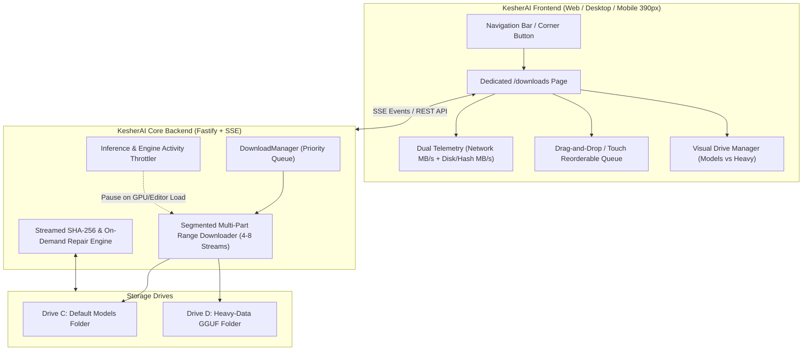

# What KesherAI's Downloads Page Can Learn from the New Epic Games Launcher (Preview) Downloads Page

## Summary

This research investigates the downloads and library management experience of the rebuilt **Epic Games Launcher Preview** (released in October 2026, building upon the March 2025 Download Manager update) alongside industry benchmarks from **Valve's Steam** and the **Microsoft Xbox App on PC**. It analyzes how high-performance game launchers manage multi-gigabyte payloads (10–100+ GB) under constrained bandwidth, disk I/O bottlenecks, and background system loads. 

KesherAI routinely handles heavy multi-gigabyte assets on home PCs—specifically Hugging Face model weights (1–20 GB GGUF, safetensors, diffusion checkpoints), inference runtimes (llama.cpp, stable-diffusion.cpp, ComfyUI), and game engine tools (Unreal Engine 5.8+ and Unity 6 bridge plugins)—frequently monitored or initiated remotely from mobile phones (390 px viewport). This report contrasts KesherAI's current minimal download implementation (`apps/web/src/Downloads.tsx`, `packages/downloads/src/downloader.ts`) with modern launcher architectures. It details concrete features KesherAI should adopt: a dedicated full-page download hub with mobile-responsive layouts, dual-phase telemetry (differentiating network download from SHA-256 disk verification), multi-part parallel range chunking, drag-and-drop priority queueing, visual multi-drive storage management, inference-aware auto-pausing, on-demand file integrity verification, and mobile push notifications.

---

## 1. KesherAI's Current Downloads Architecture and Operational Bottlenecks

### 1.1 Architecture and Codebase Structure
KesherAI currently organizes its download infrastructure across four principal modules:
1. **Frontend Flyout Interface (`apps/web/src/Downloads.tsx`):**
   - Implements `DownloadsButton`: a floating bottom-right corner circular button displaying an SVG progress ring based on aggregate bytes received (`totals.got / totals.all`) and a numerical badge count of active/failed jobs.
   - Clicking the button expands a fixed-width popover card (`.dl-panel`) containing a list of download jobs, individual progress bars, speed readout (MB/s), estimated time remaining (`eta()`), and actions: Pause (`POST /api/downloads/:id/pause`), Resume (`POST /api/downloads/:id/retry`), Cancel/Dismiss (`DELETE /api/downloads/:id`), and Retry.
   - Provides a global bandwidth limit dropdown with fixed values `[0 (No limit), 1, 2, 5, 10, 20, 50 MB/s]` mapped to `PUT /api/downloads/limit`.
   - Embeds contextual widgets: `DownloadBar` (inline on model cards in `apps/web/src/pages/Models.tsx`) and `DownloadsMatching` (regex-matched grouped components).
2. **Server-Side Queue Routing (`packages/core/src/routes/downloads.ts`):**
   - Routes include `/api/downloads` (GET list, POST enqueue), `/api/downloads/limit` (GET/PUT bandwidth throttling), `/api/downloads/plan` (pre-flight sizing and hardware fit assessment), and `/api/downloads/events` (Server-Sent Events stream for real-time progress).
   - Manages drive targets through `driveChoices()`: distinguishing between the primary `models` directory (`s.paths.models`) and a configured secondary `heavy` drive (`s.config.heavyDir`) for large chat GGUF files.
   - Maintains a persistence manifest (`downloads-pending.json`) so interrupted downloads automatically resume from their temporary `.part` files 8 seconds after server startup.
3. **Core Engine Downloader (`packages/downloads/src/downloader.ts`):**
   - Uses an event-driven `DownloadManager` class with default serialization (`concurrency = 1`), under the premise that large monolithic files download faster without connection contention.
   - Performs resumable downloads via standard HTTP `Range: bytes={existing}-` requests, piping the stream through a chunk throttle (`Transform` stream) into a `.part` file.
   - Carries out sequential SHA-256 hashing (`sha256File`) upon stream completion, renaming `.part` to the destination path if valid, or unlinking on hash mismatch.
   - Performs a rudimentary pre-flight disk check against `freeSpace(dirname(req.dest))` requiring `need + Math.min(256 MB, need)` bytes free.
4. **Multi-Part Fast Downloader (`packages/core/src/fast-download.ts`):**
   - Contains a segmented parallel range downloader (`fastDownload`) running up to 4–8 concurrent chunk workers with automatic stall detection (30-second timeout per part).
   - *Crucial Disconnect:* This accelerated engine is currently restricted to application updater executables; it is not hooked into `DownloadManager` for Hugging Face models or engine binaries.

### 1.2 Observed Friction Points
- **No Dedicated Full-Page View:** The interface relies solely on the small floating popover. When a user queues multiple large models (e.g., a 14 GB LLM, a 12 GB Flux checkpoint, a vision encoder, and a runtime engine), the popover becomes vertically cramped, difficult to scroll, and awkward to manage on desktop monitors.
- **Strict FIFO Serialization Without Reordering:** With `concurrency = 1`, jobs process in strict arrival order. If a user starts a 16 GB checkpoint download and subsequently queues a critical 800 MB text model or engine update, the small model is blocked for hours unless the user manually cancels or pauses the preceding job.
- **The "Verifying" Black Hole:** Hashing a 15–20 GB GGUF on standard NVMe or SATA drives takes between 25 and 90 seconds. In KesherAI's UI, the job status switches to `verifying`, the speed drops to 0 MB/s, the progress bar locks at 100%, and the user receives no telemetry, creating the false appearance of an application freeze.
- **Single-Connection Bottlenecks:** Hugging Face CDNs (Cloudflare / CloudFront edge nodes) often throttle single TCP connections depending on regional routing. The model downloader does not leverage multi-part range downloading.
- **Phone UI Limitations (390 px Viewport):** On mobile devices, the floating button previously obstructed interactive action buttons on engine pages. Finished downloads are hidden from the popover on mobile, requiring users to navigate to the Models page to verify success.

---

## 2. Deep Dive: The New Epic Games Launcher Preview & Download Experience

### 2.1 Evolution and Context
The digital distribution landscape has faced mounting user criticism over bloated, sluggish desktop clients. In response, Epic Games initiated a comprehensive overhaul of its distribution stack:
- **March 27, 2025 (Download Manager Redesign):** Epic deployed an overhauled Download Manager for the legacy desktop client on Windows and macOS [1, 2]. This update introduced essential queue controls: drag-and-drop prioritization, explicit download speed limits, scheduled update windows, background patching controls during active gameplay, and a persistent download history log [1].
- **October 14, 2026 (Ground-Up "Early Preview" Architecture):** Epic launched a public Early Preview of an entirely rebuilt Epic Games Launcher across Windows (x64), macOS (Apple Silicon), and—for the first time officially—Linux (via AppImage and native `.deb` packages) [3, 4]. Developed using a modern, streamlined codebase (publicly characterized by Epic as a lightweight "speedboat and not a yacht") [4, 5], the preview reduced the client disk footprint to approximately 300 MB, demonstrated cold-boot times roughly 46% faster than Steam (~5.47 seconds vs. ~10.1 seconds), achieved near-instant wake from tray (~0.36 seconds), and accelerated library render times up to 30x [5, 6].

### 2.2 Queue and Priority Management
The Epic Games Launcher Preview re-architected how queues are presented and manipulated:
- **Centralized Download Hub:** Positioned prominently via a dedicated button in the bottom-center navigation bar (shifting away from the obscure bottom-left flyout of the legacy launcher) [1, 7], opening into a full-window download and update dashboard.
- **Drag-and-Drop Reordering:** Users can grab any queued item and drag it vertically within the queue list to elevate or depress its priority [1].
- **One-Click Priority Elevation:** Queued items include a direct "Download Next" / "Move to Top" action, immediately placing the selected title behind the active job without forcing manual re-sorting [1, 7].
- **Queue State Differentiation:** Items in the queue clearly state their execution status: `Downloading`, `Queued`, `Paused`, `Verifying`, `Patching`, or `Scheduled` [1, 3].

### 2.3 Granular Pause, Resume, and Cancellation
- **Global and Per-Item Controls:** A global "Pause All" and "Resume All" header button allows instant suspension of all network and disk operations when system bandwidth or I/O is required elsewhere [1].
- **Clean Resumption Semantics:** Downloads maintain robust temporary chunk manifests (`.egstore` / `.item` staging files). Pausing halts the write buffer immediately without discarding completed chunk trees. Resuming queries the local chunk index, bypassing redundant payload retrieval [1, 8].

### 2.4 Multi-Phase Progress and Dual Telemetry (Network vs. Disk)
A hallmark of modern high-payload distribution is separating network ingress from local storage operations:
- **Separate Network and Disk I/O Gauges:** The Download Manager displays two concurrent, real-time performance indicators:
  1. *Network Download Speed:* The incoming transfer rate over HTTP/CDN (e.g., `48.2 MB/s`) [1, 7].
  2. *Disk Operations (Read/Write):* The disk throughput rate during file allocation, chunk decompression, delta patching, and verification (e.g., `124.0 MB/s Write`, `32.1 MB/s Read`) [1, 3].
- **Multi-Stage Visual Indicators:** Progress is visually partitioned into distinct operational phases:
  - *Allocating / Initializing:* Reserving unfragmented disk clusters.
  - *Downloading & Writing:* Fetching compressed manifests and streaming chunks.
  - *Verifying / Validating:* Reading local files and computing cryptographic block hashes [8].
  - *Cleaning Up / Finalizing:* Moving staging files into target library folders and stripping transient markers.

### 2.5 Dynamic Speed Calculation and Time Estimation
- **Combined Pipeline ETA:** Time remaining does not rely solely on `(total_bytes - received_bytes) / network_speed`. The preview's calculation engine factors in disk write performance and remaining verification blocks, preventing misleading estimates when network bandwidth is high but mechanical or saturated SSD write speeds cause a pipeline stall [1, 7].
- **Moving Average Smoothing:** Instantaneous spikes are filtered through an exponential moving average (EMA) window, ensuring the displayed ETA does not oscillate erratically during TCP congestion adjustments [1].

### 2.6 Bandwidth Throttling and Network Scheduling
- **Custom Download Speed Limits:** In client settings, users can define an absolute bandwidth cap (in KB/s or MB/s) [1, 9].
- **Operational Mode Splitting:** The launcher allows separate policies for fresh user-initiated installations (which typically run unconstrained) versus automatic background game updates (which can be constrained to avoid degrading general web browsing) [1].

### 2.7 Install Locations, Storage Awareness, and Headroom Checks
- **Multi-Directory / Multi-Drive Configuration:** Users can define and label multiple installation paths across different local or external partitions [1].
- **Pre-Flight Disk Space Checks & Headroom Buffers:** Before initiating a payload, the launcher calculates both final footprint and staging overhead. For delta updates, unpacking and patching may require 1.5x–2.0x the patch size in temporary headroom. If free space is insufficient, the operation halts immediately with specific diagnostic error codes (`IS-DS01`: Insufficient disk space before install; `IS-DS02`: Disk full during write) [8, 10].
- **Selective Component Installation:** Major titles (e.g., *Fortnite*, *Unreal Engine*) allow modular installation, enabling users to deselect optional heavy assets like high-resolution textures, raytracing content, or optional language packages, substantially reducing disk consumption [8].

### 2.8 Verification, Integrity Repair, and Block Patching
- **On-Demand Integrity Validation:** Users can open any installed item's context menu (`...` -> *Manage* -> *Verify*) at any time [8].
- **Chunk-Level Differential Repair:** The launcher evaluates local file chunks against cloud-hosted manifest SHA hashes. If corruption or tampering is detected, it does not re-download the entire multi-gigabyte package; it fetches only the damaged 1 MB–64 MB blocks and repatches the binary in-place [8].

### 2.9 Background Operations, Auto-Updates, and "Install When Idle"
- **Gameplay-Aware Throttling:** Users can toggle "Allow downloads during gameplay." When disabled, active execution of any 3D game immediately suspends or throttles active downloads to prevent frame jitter and ping degradation [1].
- **Scheduled Maintenance Windows:** Provides an automated time-range configuration (e.g., restrict background auto-updates to 02:00–06:00), ensuring heavy downloads execute during off-peak ISP hours [1].
- **Idle Processing:** Background patching tasks execute when user input is idle, minimizing interference with interactive desktop workflows [1].

### 2.10 Notifications and Error Reporting
- **Native OS Desktop Integration:** Dispatches native operating system notifications (Windows Action Center, macOS Notification Center, Linux Freedesktop notifications) when an installation or repair completes [1].
- **Transparent, Actionable Error Codes:** Replaces generic "Download failed" labels with specific, documented error identifiers (e.g., `IS-DS01` for storage, `IS-MF01` for manifest retrieval, `IS-IN-FC02` for file write permission denied) linked directly to knowledge-base remediation articles [8, 10].

---

## 3. Comparative Benchmark: Epic Games Preview vs. Steam vs. Xbox App on PC

| Operational Dimension | Epic Games Launcher Preview (Oct 2026 / Mar 2025) | Valve Steam (Redesigned Download & Storage Hub) | Microsoft Xbox App for PC (Windows 11) | KesherAI Current State |
| :--- | :--- | :--- | :--- | :--- |
| **Interface Model** | Centralized full-page Download Hub + bottom-center quick status button [1, 3]. | Full-page Downloads manager + bottom status bar with live graph overlay [11, 12]. | "My Library" integrated queue tab in left navigation rail [13]. | Small floating corner button (`DownloadsButton`) + small popover card (`.dl-panel`). |
| **Queue Control & Reordering** | Full drag-and-drop reordering; "Download Next" priority elevation [1]. | Full drag-and-drop reordering; paused items display faded progress state [11, 12]. | Simple vertical queue; manual click to switch active title [13]. | Strict FIFO queue; no reordering; pause/resume individual items. |
| **Telemetry & Meters** | Dual readouts: Network speed (MB/s) + Disk Read/Write speed (MB/s) [1, 3]. | Unified progress bar combining network download and disk allocation/patching [11, 12]. | Single progress bar; download speed and downloaded/total GB [13]. | Single progress bar; network speed (MB/s) + received/total GB; opaque `verifying` status. |
| **Storage & Drive Management** | Multi-directory selection; pre-flight headroom validation; `IS-DS01` alerts [1, 8]. | Dedicated visual **Storage Manager** with color-coded drive bars and 1-click game moving [11, 14]. | Drive selector at install; default drive setting in General options (NTFS only) [13]. | Backend support for `models` vs `heavy` drives; basic `freeGb` pre-flight check in modal. |
| **Verification & Repair** | On-demand "Verify"; chunk-level delta repair downloading damaged blocks [8]. | "Verify integrity of game files"; depot manifest check; selective chunk re-acquisition [11]. | "Verify and repair" under *Manage > Files*; scans package integrity [13]. | Automatic SHA-256 validation only at initial download completion; deletes `.part` on error. |
| **Bandwidth & Scheduling** | Explicit speed limits; separate rules for fresh installs vs updates; off-peak scheduler [1]. | Explicit speed limits; auto-throttling during streaming; off-peak update schedule [11]. | Defers throttling to Windows OS Delivery Optimization settings (percentage/Mbps) [13]. | Global dropdown limit `[0, 1, 2, 5, 10, 20, 50 MB/s]` stored in app config. |
| **Activity-Aware Throttling** | Auto-pauses/throttles when a game is running unless overridden by user [1]. | Automatically pauses downloads when a game launches (per-game override available) [11]. | Automatically manages bandwidth via Windows Gaming Services priorities [13]. | Downloads run unthrottled during local LLM generation or game engine compilation. |
| **Mobile & Remote Control** | Mobile Epic Games Store app manages mobile titles; limited desktop remote queueing [3]. | Steam Mobile app allows remote installation triggers to authorized desktop PCs. | Xbox Mobile app supports remote console/PC installation trigger. | Fully accessible and controllable via mobile web browser (390 px responsive interface). |
| **Error Transparency** | Explicit diagnostic error codes (`IS-DS01`, `IS-MF01`) with direct help links [8, 10]. | Clear status badges ("Disk write error", "Corrupt download", "App running") [11]. | Cryptic Windows Store error codes (`0x80070005`, `0x80073D02`) [13]. | Raw Node.js error strings (e.g., `fetch failed: ECONNRESET` or `HTTP 502`). |

### 3.1 Key Lessons from Steam
Valve's redesign demonstrated that users find immense value in **visual storage management** and **unified progress tracking** [11, 14]. Steam's Storage Manager provides horizontal capacity bars showing exactly how much space is consumed by games, DLC, and workshop mods across each connected SSD or hard drive [14]. Furthermore, Steam's contextual tooltip breakdown (distinguishing base content, DLC, shader pre-caching, and workshop mods) prevents user confusion over why a 200 MB patch triggers a 40 GB disk write cycle [11, 12].

### 3.2 Key Lessons and Warnings from the Xbox App
The Xbox PC App illustrates the risks of **opaque system coupling** [13]. By delegating download throttling, drive formatting, and queue synchronization to Windows background services (Gaming Services, Delivery Optimization), users frequently suffer from registry desynchronization, permission errors, and cryptic hex error codes that require PowerShell intervention (`remove-AppxPackage`) [13]. KesherAI must avoid depending on OS-level background daemons, keeping its download pipeline self-contained within Node.js / Electron.

---

## 4. Synthesis: Where Sources and Ecosystem Approaches Disagree

### 4.1 Single Unified Progress Bar vs. Dual Distinct Meters
- *Steam's Approach:* Combines network transfer, file writing, and verification into a single unified progress bar that accounts for the complete pipeline, eliminating the scenario where a download hits 100% but remains unusable [11, 12].
- *Epic Games' Approach:* Maintains distinct visual progress metrics and independent network vs. disk speed gauges, giving technical users explicit insight into whether their ISP connection or their local drive write speed is the bottleneck [1, 3].
- *Resolution for KesherAI:* For AI model distribution, Epic's model is superior. Downloading a 14 GB GGUF over gigabit internet takes ~2 minutes, but hashing and writing to a standard drive can take another minute. Displaying separate "Download Speed: 90 MB/s" and "Hashing Speed: 250 MB/s" prevents users from assuming the process has hung.

### 4.2 Monolithic Serialization vs. Concurrent Chunk Ingestion
- *Standard Game Launchers (Steam/Epic):* Split massive game archives into thousands of 1 MB–64 MB compressed chunks fetched across multiple HTTP connections simultaneously [8].
- *AI Hubs (Hugging Face / KesherAI):* Distribute monolithic binary files (e.g., a single 18.2 GB `.gguf` file or 22 GB `.safetensors` checkpoint).
- *Resolution for KesherAI:* While KesherAI serializes *jobs* (`concurrency = 1` prevents drive thrashing), downloading a single monolithic 15 GB file over a single HTTP connection is inefficient. KesherAI should apply its internal `fastDownload` logic (HTTP `Range` chunks in parallel) to the active model download.

### 4.3 Staging Headroom Margins
- *Epic Games Launcher:* Enforces strict staging buffers, frequently demanding up to 2x the package size to accommodate concurrent download, extraction, and delta-patching, throwing `IS-DS01` if space is lacking [8, 10].
- *Community Criticism:* Users with constrained 500 GB SSDs frequently complain that Epic refuses to update a 60 GB game when 40 GB of free space remains, even if the final update delta is only 5 GB.
- *Resolution for KesherAI:* AI model weights are generally non-delta, static files. KesherAI should verify `file.size + 512 MB` rather than an aggressive 2x multiplier, avoiding false-positive disk space refusals.

---

## 5. Blueprint: What KesherAI's Downloads Page Should Copy and Adapt

KesherAI operates in a distinct environment: a local Node.js server running on a home developer PC, executing heavy inference and game engine tasks, accessed directly on the desktop or via mobile phones over local Wi-Fi and tunnels. The following concrete adaptations should be implemented:

### 5.1 A Dedicated Full-Page Downloads Hub (`/downloads`)
- **Dual Representation:** Retain the lightweight floating corner button (`DownloadsButton`) for universal status indication across all screens, but clicking "Expand" or navigating to `#/downloads` opens a full-screen dashboard.
- **Mobile-Responsive Adaptive Layout:**
  - *Desktop (>768 px):* Comprehensive multi-column table displaying Model/Tool Name, Target Drive, Network Speed, Disk Write Speed, Elapsed/Remaining Time, and Drag Handles.
  - *Phone (390 px):* Card-based view with stacked touch controls ("Move to Top", "Pause", "Cancel"), clear progress rings, and collapsible technical telemetry.

### 5.2 Two-Tier Telemetry: Network Ingress vs. Disk/Hash Processing
- **Streamlined Status Progression:** Introduce four explicit visual phases in `Job`:
  1. `Queued` (waiting in line)
  2. `Downloading` (active network streaming with live MB/s)
  3. `Verifying` (active SHA-256 hashing with live MB/s read speed and % completed)
  4. `Ready` (verified and moved to destination folder)
- **Eliminating the Verification Blind Spot:** During the `verifying` phase, stream progress events showing hashed bytes versus total bytes, displaying an active progress bar with text such as: `Verifying SHA-256: 8.4 GB / 14.2 GB (320 MB/s)`.

### 5.3 Parallel Range Chunking for Hugging Face Assets
- Bridge the existing `packages/core/src/fast-download.ts` engine into `packages/downloads/src/downloader.ts`.
- When downloading files larger than 1 GB from Hugging Face or GitHub releases, initiate 4 parallel HTTP `Range` streams into pre-allocated byte offsets of the `.part` file. This maximizes residential fiber connections without increasing server-side burden.

### 5.4 Drag-and-Drop and Touch-Friendly Queue Reordering
- Enhance `DownloadManager` in `downloader.ts` to support dynamic queue re-indexing:
  - `reorder(id: string, targetIndex: number): void`
  - `promote(id: string): void` (instantly moves item to index 0 of the queued list).
- On mobile devices (390 px), provide simple "▲ Move Up" and "Top" touch buttons alongside desktop drag-and-drop handles.

### 5.5 Visual Multi-Drive Storage Manager
- Adopt Steam and Epic's storage visualizer: display clear horizontal capacity bars for configured paths (`models` directory vs. `heavy` directory):
  - `Drive C: (SSD) [========--------] 48 GB Free / 512 GB Total`
  - `Drive D: (HDD) [==============--] 320 GB Free / 2000 GB Total`
- Provide a simple action on downloaded model cards: `Move to Heavy Drive` or `Move to Fast SSD`, performing an atomic file move between directories and updating KesherAI's model discovery index automatically.

### 5.6 Inference-Aware and Game-Engine-Aware Auto-Throttling
- When local models (llama.cpp or stable-diffusion.cpp) are actively generating tokens or generating images, PCI-e bandwidth, RAM, and CPU threads are heavily utilized.
- Similarly, when the Unreal Engine or Unity bridge is actively compiling Blueprints or executing headless test passes, background disk I/O degrades editor responsiveness.
- Introduce an auto-pause toggle: *"Pause downloads while generating or compiling"*. The backend `DownloadManager` can subscribe to `engine.status().running` or `unreal.busy` and temporarily pause active chunk streaming, resuming automatically when generation completes.

### 5.7 On-Demand Integrity Verification
- In the Models and Tools library views, add a "Verify Integrity" option in the context menu for already downloaded models.
- Allows users to re-run SHA-256 validation against the original Hugging Face remote commit hash without re-downloading, isolating corrupted model weights or truncated GGUF files after system crashes.

### 5.8 Push Notifications for Mobile and Desktop
- When multi-gigabyte downloads complete while a user is away from the PC or managing the system via phone:
  - Desktop: Trigger HTML5 / Electron desktop notifications.
  - Phone: Dispatch Web Push notifications via KesherAI's existing remote tunnel / SSE infrastructure (`"Model FLUX.1-schnell (12.4 GB) ready to run"`).

### 5.9 Categorized, Actionable Diagnostic Error Cards
- Replace raw Node error strings with structured, localized error badges:
  - `[Storage Full]` - *Needs 4.2 GB on Drive D:. Free up space and press Retry.*
  - `[Network Dropped]` - *Hugging Face connection timed out. Retrying in 10s (Attempt 2/4)...*
  - `[Token Required]` - *Gated Hugging Face repository. Add token in Settings > API Keys.*

---

## 6. Conclusion

The October 2026 Epic Games Launcher Early Preview demonstrated that large asset managers do not need to be bloated or sluggish; modern distribution clients can be lightweight (~300 MB), boot in seconds, and provide deep operational visibility. For KesherAI, which routinely transfers and stages 1–20 GB AI models and game development tools on consumer hardware, adopting the core paradigms of the Epic Games preview—specifically dual network/disk telemetry, drag-and-drop queue prioritization, parallel chunk acceleration, visual storage management, and activity-aware throttling—will transform its download experience from a basic background utility into a robust, high-performance asset management hub suitable for both desktop workstations and remote mobile control.

---

## 7. Sources

1. [Epic Games Store - The Epic Games Store launcher gets a brand new Download Manager (March 27, 2025)](https://store.epicgames.com/en-US/news/the-epic-games-store-launcher-gets-a-brand-new-download-manager)
2. [Epic Games Community Discussion - New Download Manager Features and Controls (March 2025)](https://www.reddit.com/r/EpicGamesPC/comments/1jkc0r4/the_epic_games_store_launcher_gets_a_brand_new/)
3. [Epic Games Store - The new Epic Games Launcher is finally here in Preview (October 14, 2026)](https://store.epicgames.com/en-US/news/the-new-epic-games-launcher-is-finally-here-in-preview)
4. [Epic Games Newsroom - Early Preview Announcement and Multi-Platform Architecture (October 2026)](https://store.epicgames.com/en-US/news/epic-games-launcher-early-preview)
5. [IGN - Hands-on Impressions: Epic Games Launcher Early Preview Built for Speed (October 2026)](https://www.ign.com/articles/epic-games-launcher-preview-vibe-coded-faster-cold-start)
6. [GamingOnLinux - Epic Games Launcher Preview Arrives with Native Linux Support (October 2026)](https://www.gamingonlinux.com/2026/10/epic-games-launcher-early-preview-linux/)
7. [TechSpot - Epic Games Overhauls Launcher Architecture to Fix Resource Consumption (October 2026)](https://www.techspot.com/news/105150-epic-games-launcher-preview-performance.html)
8. [Epic Games Support - Troubleshooting Downloads, Disk Space Errors, and Verifying Game Files](https://www.epicgames.com/help/en-US/c-Category_EpicGamesStore/c-EpicGamesLauncher/how-do-i-verify-game-files-in-the-epic-games-launcher-a000084923)
9. [Epic Games Support - How to Enable Download Speed Caps and Bandwidth Limits](https://www.epicgames.com/help/en-US/c-Category_EpicGamesStore/c-EpicGamesLauncher/how-do-i-troubleshoot-download-and-installation-issues-in-the-epic-games-launcher-a000084918)
10. [Epic Games Support - Resolving IS-DS01 and IS-DS02 Disk Space Errors](https://www.epicgames.com/help/en-US/c-Category_EpicGamesStore/c-EpicGamesLauncher/error-is-ds01-out-of-disk-space-a000084900)
11. [Eurogamer - Valve Revamps Steam's Downloads Page and Storage Management](https://www.eurogamer.net/valve-revamps-steams-downloads-page-and-storage-management)
12. [Windows Central - Steam's Massive Download Manager Overhaul and Progress Tracking](https://www.windowscentral.com/steams-massive-download-manager-overhaul-now-available-everyone)
13. [Xbox Support - Troubleshoot Game Installations and Downloads on Windows](https://support.xbox.com/en-US/help/games-apps/troubleshooting/troubleshoot-games-windows-10)
14. [PC Gamer - Valve Overhauls Steam's Downloads Page with Redesign and New Storage Manager](https://www.pcgamer.com/valve-overhauls-steams-downloads-page-with-a-redesign-and-a-new-storage-manager/)
