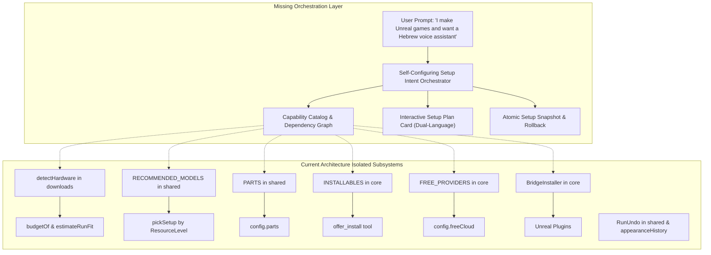
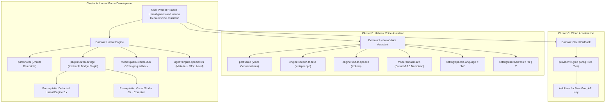
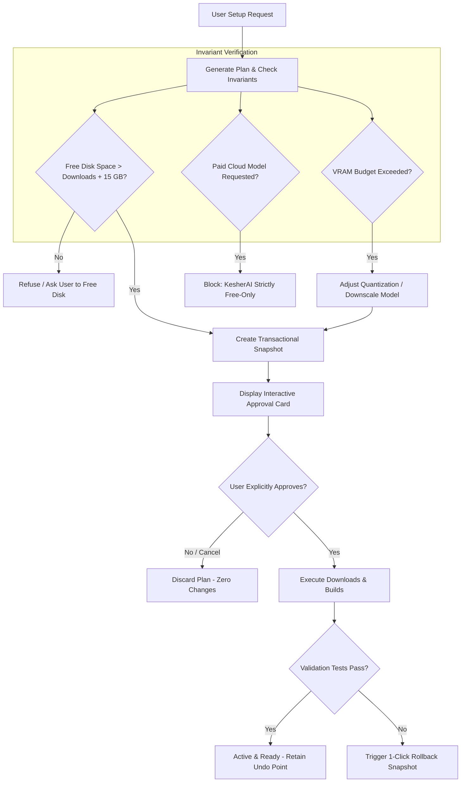
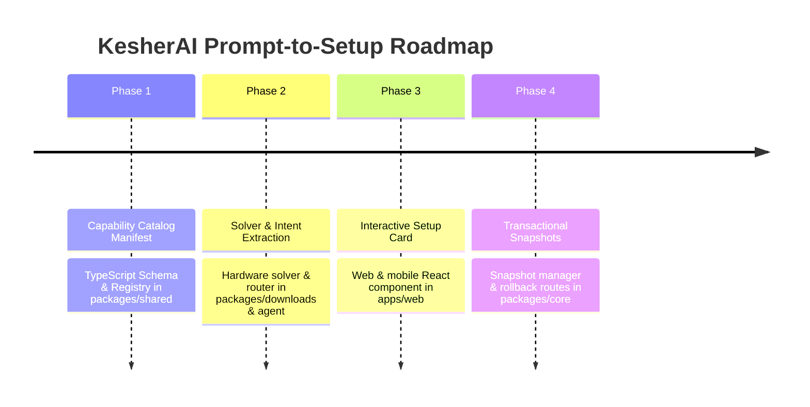

# Research: KesherAI Sets Itself Up from What the User Asks — Self-Configuring Setup by Prompt

## Summary

This research establishes the complete architectural blueprint for KesherAI to configure itself autonomously from a single natural-language user prompt (e.g., *"I make Unreal games and want a Hebrew voice assistant"*). Today, configuring a full-stack local AI environment requires manual, error-prone coordination: scanning hardware capabilities, calculating VRAM budgets for quantizations, downloading engine runtimes, cloning and compiling plugins, flipping modular feature flags, and configuring cloud fallback providers. 

By analyzing the state of the art across desktop LLM runners (*LM Studio, Jan, Msty, Ollama*), creative node managers (*ComfyUI Manager*), declarative scriptable environments (*Pinokio*), context-engineering coding assistants (*Cursor, Windsurf, Claude Code*), workspace template systems (*VS Code Profiles*), intent-driven smart home platforms (*Home Assistant Assist, Apple iOS Shortcuts*), and modular engine hubs (*Unity Hub, Epic Games Launcher*), we extract the fundamental design principles of intent-based configuration. 

We map these principles directly onto KesherAI's existing codebase—unifying its hardware detection (`detectHardware`), memory budgeting (`budgetOf`, `estimateRunFit`), model catalogs (`RECOMMENDED_MODELS`, `pickSetup`), modular parts (`PARTS`, `partOn`), installable engines (`INSTALLABLES`), free cloud providers (`FREE_PROVIDERS`), and engine installers (`BridgeInstaller`). We specify a formal, machine-readable **Capability Catalog** and a **Two-Phase Intent Planner** that generates an interactive, fully inspectable **Setup Plan Card**. The user approves all operations prior to execution, every step is guarded by strict disk and zero-cost constraints, any changes can be rolled back with a single-click undo snapshot, and the entire flow operates seamlessly on a 390 px mobile screen over remote Tailscale/Cloudflare tunnels.

---

## 1. State of the Art: How Others Do Onboarding and Configuration by Intent

Self-configuration by intent bridges human conversational desires and rigid local execution environments. Analyzing eight distinct software ecosystems reveals how industry leaders inspect systems, resolve dependencies, and present choices to users.

### 1.1 Desktop LLM Launchers (LM Studio, Jan, Msty, Ollama, LobeHub)
Local AI desktop applications have evolved from raw terminal wrappers into hardware-aware model managers:

- **Hardware Inspection & Budgeting:**
  - *LM Studio (v0.3.x)* uses a background hardware scanner that interrogates the OS for GPU vendor, driver version, total VRAM, and system RAM [1]. For Apple Silicon (M-series), it identifies unified memory ceilings (typically capping allocations to ~75% of total unified memory to prevent macOS window server crashes) [1, 2].
  - *Jan.ai* embeds runtime hardware profiling into its core engine. On first run, Jan scans VRAM and RAM to display visual **"Fit Pills"** on every model card: **"Fits"** (100% GPU offload), **"May be slow"** (partial CPU/system RAM offload), or **"Won't fit"** (exceeds total system memory) [3].
  - *Msty* provides a dedicated **"Model Matchmaker"** and built-in VRAM calculator [4]. Instead of forcing users to understand parameter counts and quantization formats, it prompts users for their primary intent (General Chat, Coding, Creative Writing, Vision) and pairs that intent with their measured hardware profile [4].
  - *Ollama* automates GPU offload dynamically during model initialization. Ollama probes `nvidia-smi`, ROCm, or Metal runtime buffers, calculating layer offload on the fly without requiring user intervention.
- **Rules of Thumb for Model Weights and Context:**
  - Standard 4-bit quantization (`Q4_K_M`) requires approximately **$0.5\text{ to }0.6\text{ GB}$ per 1 billion parameters** [1, 2].
  - Working memory overhead includes the KV cache and compute scratch buffers:
    $$\text{Memory}_{\text{total}} = \text{FileBytes} + \text{KVCache}(\text{context}, \text{params}) + \text{ComputeBuffer}$$
    For example, an 8B model with an 8k context window at 16-bit KV requires $\sim 5.0\text{ GB weights} + 1.0\text{ GB KV} + 0.5\text{ GB headroom} \approx 6.5\text{ GB VRAM}$ [2].
- **Starter Recommendations by Hardware Tier:**
  - *Low Tier (8 GB RAM / No GPU or $\le 4\text{ GB}$ VRAM):* 3B–4B models (e.g., Llama 3.2 3B, Qwen 2.5/3 4B) [1, 2].
  - *Mid Tier (16 GB RAM / 8–12 GB VRAM):* 7B–14B models (e.g., Qwen3 8B/14B, DictaLM 3.0 12B) [1, 2].
  - *High Tier (32+ GB RAM / 16–24 GB VRAM or 36+ GB Mac):* 20B–32B dense models or 30B MoE (e.g., Qwen3 Coder 30B, DeepSeek-R1 distills) [1, 4].

### 1.2 Creative Tool Dependency Resolution (ComfyUI Manager)
ComfyUI's ecosystem relies on thousands of fragmented custom nodes and third-party checkpoints. The **ComfyUI-Manager** solved this distribution bottleneck via automated workflow dependency extraction [5]:

- **Workflow Metadata Inspection:** Every ComfyUI workflow saved in a `.json` file or embedded inside PNG metadata contains an explicit list of graph nodes:
  ```json
  { "nodes": [ { "type": "KSampler" }, { "type": "ImpactPack/Detailer" }, ... ] }
  ```
- **Registry Cross-Referencing:** When a user drags a workflow into ComfyUI, the client inspects all node types against the installed python packages. Any unmatched node type triggers a red highlight and activates the **"Install Missing Custom Nodes"** engine [5].
- **Batch Resolution & Installation:** ComfyUI-Manager queries a central `custom-node-list.json` registry, maps node classes to Git repository URLs, executes automated `git clone` commands into `custom_nodes/`, runs `pip install -r requirements.txt`, and prompts the user to restart the server [5].
- **Checkpoint/Model Auto-Detection:** If a workflow requires a specific checkpoint (e.g., `flux1-dev.safetensors`), ComfyUI-Manager queries Hugging Face and Civitai APIs, matching model hashes and filenames to provide 1-click download links directly inside the missing nodes dialog [5].

### 1.3 Declarative Environment & Scriptable Installers (Pinokio)
Pinokio treats complex AI applications (Stable Diffusion WebUI, Kohya_ss, Ollama, ComfyUI, Whisper) as automated state machines managed via declarative JSON/JS scripts (`pinokio.js`, `install.json`, `start.json`) [6]:

- **Declarative Primitives:** Scripts chain discrete operating system steps into JSON arrays:
  - `shell.run`: Executes commands (e.g., cloning Git repos, creating virtual environments) [6].
  - `shell.enter`: Simulates interactive terminal input for activating environments (`source env/bin/activate` or `env\Scripts\activate`) [6].
  - `fs.download`: Downloads large files (e.g., Hugging Face `.safetensors` or `.gguf` checkpoints) directly to target directories [6].
  - `fs.link`: Creates directory symlinks and hardlinks, allowing multiple local AI tools to share common model directories without duplicating disk consumption [6].
  - `input`: Prompts the user with structured UI forms for mandatory credentials or configurations (e.g., Hugging Face token, target ports) before resuming execution [6].
- **Inline Platform Templating:** Pinokio scripts use runtime JavaScript templating (`{{os.platform() === 'win32' ? ... : ...}}`) to resolve OS-specific differences (PowerShell vs. Bash, CUDA vs. ROCm vs. Metal) [6].

### 1.4 Context Engineering & Project Rules (Cursor, Windsurf, Claude Code)
Modern coding agents do not guess project conventions; they ingest structured context rules:

- **Rule Files:** `.cursorrules` / `.cursor/rules/*.mdc` (Cursor), `.windsurfrules` (Windsurf), and `CLAUDE.md` (Claude Code) inject project architecture, testing guidelines, and constraints directly into the agent's system prompt [7, 8].
- **Dynamic Glob Scoping:** Cursor's MDC format allows rules to activate conditionally based on file patterns (e.g., `*.uproject` or `*.cpp` loads Unreal Engine conventions; `*.ts` loads TypeScript standards) [7].
- **Hierarchical Discovery:** Agents discover configuration files by walking from the current working directory up to the Git repository root, ensuring mono-repos can define global rules as well as package-specific overrides [7, 8].

### 1.5 IDE Profiles & Prompt-Driven Workspaces (VS Code Profiles)
VS Code decoupled editor state from the global application instance via **Profiles** [9]:

- **Encapsulated State:** A profile encapsulates `settings.json`, `keybindings.json`, snippets, tasks, and an explicit list of enabled extensions (`extensions.json`) [9].
- **Workspace-Profile Binding:** Workspaces can define a default profile. Opening an Unreal C++ folder automatically activates the "Unreal Engine" profile (C++, CMake, Blueprint formatters), whereas opening a web app activates the "Web Development" profile [9].
- **Template Sharing & Export:** Profiles can be exported as `.code-profile` JSON bundles or GitHub Gists. Importing a profile creates a complete development setup in seconds [9].

### 1.6 Intent-Driven Smart Home & System Automations (Home Assistant Assist, Apple iOS Shortcuts)
- **Home Assistant Assist:** Converts natural language into structured intents via an intent-pipeline [10]:
  $$\text{User Utterance} \xrightarrow{\text{LLM/Parser}} \text{Intent}(\text{HassTurnOn}) + \text{Slots}(\{\text{domain: 'light', area: 'kitchen'}\})$$
  Home Assistant combines this with **Blueprints**—parameterized YAML templates where users define the logic skeleton and fill in entity slots [10]. Devices are discovered autonomously via mDNS, SSDP, and Zeroconf, prompting the user with a single notification: *"New device discovered: Configure now?"* [10].
- **Apple iOS Shortcuts & App Intents:** Applications declare strongly-typed `AppIntent` structs in Swift with input parameters and display titles. Siri and Apple Intelligence dynamically construct execution graphs by chaining intents, requesting user authorization before mutating system settings or sending messages.

### 1.7 Modular Component Installers (Unity Hub, Epic Games Launcher)
- **Component Trees:** Both Unity Hub and Epic Games Launcher manage multi-gigabyte development suites using modular component manifests [11, 12]:
  - *Core Editor:* Mandatory base engine binary [11].
  - *Target Modules:* Optional platform build targets (Android Build Support with OpenJDK/NDK, Linux Mono, iOS) [11].
  - *Prerequisite Bundles:* Visual C++ Redistributables, DirectX runtimes, Windows 10/11 SDKs [12].
- **Dependency Invariant:** Sub-modules cannot be installed without their core parent version, and platform modules automatically resolve their compiler prerequisites [11, 12].

### 1.8 Agent-Configures-the-App Paradigms (Raycast, Open-Interpreter)
- **Local Tool Sandboxes:** Open Interpreter provides a local agent that executes shell and Python commands, relying on explicit approval flags (`--sandbox workspace-write` or manual confirmation prompts) before executing destructive operations [13].
- **App Configuration via Scripts:** Raycast exposes user-definable script commands and AI automations that interact with system configuration, window management, and third-party APIs via structured JSON schemas and stdin/stdout streams [14].

---

## 2. KesherAI's Existing Architectural Foundations & Gap Analysis

KesherAI already possesses sophisticated, battle-tested subsystems distributed across `packages/downloads`, `packages/shared`, `packages/core`, and `packages/agent`. However, they currently operate in isolation.



### 2.1 Existing Subsystems in KesherAI
1. **Hardware Detection (`packages/downloads/src/hardware.ts`):**
   - Detects platform, CPU cores, RAM total and free.
   - Probes NVIDIA GPUs via `nvidia-smi --query-gpu=...` (querying name, VRAM total/free, CUDA compute capability `computeCap`).
   - Probes AMD and Intel GPUs via Windows registry (`HKLM:\SYSTEM\CurrentControlSet\Control\Class\...`) and Linux sysfs (`/sys/class/drm`).
   - Identifies Apple Silicon unified memory architecture.
2. **Memory Budgeting & Run Fit (`packages/downloads/src/fit.ts`):**
   - `budgetOf(hw)` calculates usable VRAM and RAM budgets (setting GPU budget to $75\%$ of RAM on unified memory, or 0 if dedicated GPU has $<2\text{ GB}$).
   - `kvCacheBytes(billions, contextTokens, kvBytes)` accurately computes memory needed for attention contexts.
   - `estimateRunFit(fileBytes, budget, opts)` returns `"gpu"` (100% on card), `"partial"` (split with system RAM), or `"too-big"`.
3. **Model Recommendations (`packages/shared/src/recommended.ts`):**
   - Curated `RECOMMENDED_MODELS` list (Qwen3 4B, DictaLM 3.0 12B Hebrew, Qwen3 8B, Qwen3 14B, gpt-oss 20B, Qwen3 Coder 30B MoE).
   - `pickSetup(models, level)` selects optimal models based on resource levels (`conservative`, `balanced`, `extreme`).
   - `ROUTER_MODEL` (Qwen3.5 2B) for fast intent routing.
4. **Modular Parts Catalog (`packages/shared/src/parts.ts`):**
   - 19 configurable app capabilities: `images`, `video`, `image-editor`, `video-editor`, `sound-editor`, `model-editor`, `nodes` (ComfyUI), `unreal`, `unity`, `voice`, `day`, `pages`, `knowledge`, `browser`, `watch`, `pipelines`, `compare`, `study`, `chat-reports`, `community`.
   - `partOn(parts, id)` controls visibility in navigation, background processes, and tool sets.
5. **Installables Catalog (`packages/core/src/installables.ts` & `src/routes/installables.ts`):**
   - Live status tracking (`ready`, `busy`, `sizeGb`, `start`) for engines and models: `image-model`, `video-model`, `comfyui`, `chat-engine` (llama.cpp), `speech-to-text` (whisper.cpp), `text-to-speech` (Kokoro), `vision-model` (Qwen3-VL), `ffmpeg`, and the 4 creative editors.
   - `offer_install` tool (`OFFER_INSTALL_TOOL`) allowing chats to present installation buttons.
6. **Free Cloud Providers (`packages/core/src/free-cloud-catalog.ts` & `src/routes/free-cloud.ts`):**
   - Strict zero-payment catalog: Groq, OpenRouter (`:free` filter), Cloudflare Workers AI, Mistral (Experiment tier), Zhipu GLM-4-Flash.
   - Enforces rate limits, validates API keys, blocks paid models, and provides direct links to key generation pages.
7. **Engine Bridge Installers (`packages/core/src/unreal-install.ts`):**
   - `findEngines()` scans Epic Games Launcher manifests and custom source trees on Windows.
   - `BridgeInstaller` automates building the `KesherAIBridge` C++ plugin via Unreal's `RunUAT BuildPlugin`, caching the binaries and copying them into project `Plugins/` directories.
   - Unity package installer injects git URLs into `manifest.json`.
8. **Specialist Agents (`packages/shared/src/engine-specialists.ts`):**
   - Sub-agent roles: `materials` (PBR shaders, textures), `vfx` (Niagara particles), `level` (blockout, lighting, navmesh).
9. **Safety, Undo & Mobile Infrastructure:**
   - 5-second `RunUndo` countdown (`packages/shared/src/run-undo.ts`).
   - `appearanceHistory` stack in `KesherConfig` for undoing styling changes.
   - `UndoStore` in `packages/agent/src/session.ts` for file diff rollbacks.
   - `/api/quick-approve/:code` for one-tap mobile and watch notifications.
   - `/api/pc-status` reporting thermal and GPU/CPU loads to remote clients.

### 2.2 The Missing Bridge: Gap Analysis
Despite these building blocks, KesherAI lacks a unified configuration engine:
- **No Machine-Readable Capability Graph:** Subsystems do not express cross-dependencies. The Unreal part does not declare that it requires the `KesherAIBridge` plugin, benefits from `Qwen3 Coder 30B`, or coordinates with `engine-specialists`.
- **No Declarative Setup Planner:** When a user types *"I make Unreal games and want a Hebrew voice assistant"*, the agent can chat about it, but cannot assemble an end-to-end plan that activates `part:unreal` and `part:voice`, schedules downloads for `DictaLM 3.0` and `whisper.cpp`, triggers the Unreal Bridge build, and prompts for Groq API keys in one cohesive interaction.
- **No Transactional Setup Snapshot:** Changing settings, activating parts, and setting active models mutates `config.json` directly without an atomic rollback point or an "Undo Entire Setup" command.

---

## 3. Machine-Readable Capability Catalog & Dependency Graph

To allow an LLM or a deterministic solver to reason about configuration, KesherAI's settings, parts, engines, plugins, and models must be expressed as a unified **Capability Graph**.

### 3.1 Capability Schema Definition

```typescript
/** Unique capability identifiers. */
export type CapabilityId =
  | `part:${string}`        // e.g. "part:unreal", "part:voice", "part:nodes"
  | `engine:${string}`      // e.g. "engine:llama.cpp", "engine:whisper", "engine:kokoro"
  | `model:${string}`       // e.g. "model:dictalm-12b", "model:qwen3-coder-30b"
  | `plugin:${string}`      // e.g. "plugin:unreal-bridge", "plugin:image-editor"
  | `provider:${string}`    // e.g. "provider:fc-groq", "provider:fc-openrouter"
  | `agent:${string}`       // e.g. "agent:unreal-specialists", "agent:code"
  | `setting:${string}`;    // e.g. "setting:autoRoute", "setting:guard"

/** Hardware and software requirements for a capability. */
export interface CapabilityPrerequisites {
  os?: Array<"win32" | "darwin" | "linux">;
  minRamGb?: number;
  minVramGb?: number;
  cudaComputeCap?: number;
  freeDiskGb: number;
  installedSoftware?: Array<"unreal" | "unity" | "visualstudio" | "git">;
  dependsOn?: CapabilityId[];
  conflictsWith?: CapabilityId[];
}

/** Machine-readable capability descriptor. */
export interface CapabilityItem {
  id: CapabilityId;
  category: "engine" | "part" | "model" | "plugin" | "cloud" | "agent";
  title: { en: string; he: string };
  description: { en: string; he: string };
  prerequisites: CapabilityPrerequisites;
  downloadSizeGb: number;
  installedSizeGb: number;
  tags: string[]; // e.g. ["game-dev", "unreal", "hebrew", "voice", "audio", "coding"]
  
  /** Actions required to apply this capability */
  actions: {
    activatePart?: string;
    installId?: string;
    modelDownload?: { repo: string; filePattern: string };
    buildPlugin?: { kind: "unreal" | "unity" };
    configMutation?: Record<string, unknown>;
    needsApiKey?: { providerId: string; portalUrl: string };
  };
}
```

### 3.2 Mapping the Unreal + Hebrew Voice Assistant Graph

The user's prompt *"I make Unreal games and want a Hebrew voice assistant"* decomposes into two capability clusters:



### 3.3 Hardware-Aware Constraint Resolution Algorithm
When multiple capabilities compete for GPU memory (e.g., `model:dictalm-12b` at $7.5\text{ GB}$, `model:qwen3-coder-30b` at $18.6\text{ GB}$, `whisper.cpp` at $0.6\text{ GB}$, and the Unreal Editor viewport requiring VRAM), the capability solver uses a **Priority & VRAM Packing Algorithm**:

```
Algorithm 1: Hardware-Aware Capability Solver
Input: RequestedCapabilities C_req, HardwareInfo HW, ResourceLevel Level
Output: ExecutionPlan Plan

1. VRAM_budget ← budgetOf(HW).vram
2. If HW has Unreal Engine running or configured:
     VRAM_reserved ← max(2.0 GB, config.engines.fitTargetMiB / 1024)
   Else:
     VRAM_reserved ← 0.5 GB
3. VRAM_available ← max(0, VRAM_budget - VRAM_reserved)

4. Model Candidates:
     Primary Chat / Hebrew: DictaLM 3.0 12B (7.5 GB VRAM needed)
     Secondary / Coding:
       If (7.5 GB + 18.6 GB) ≤ VRAM_available:
         Pick Qwen3 Coder 30B (Local GPU)
       Else if (7.5 GB + 5.0 GB) ≤ VRAM_available:
         Pick Qwen3 8B Coder (Local GPU)
       Else:
         Pick DictaLM 3.0 12B as Primary Local Chat, and route Coding / Tool
         tasks to Free Cloud (Groq: Llama 3.3 70B / Qwen 2.5 Coder) via fc-groq.

5. Voice Engines Allocation:
     whisper.cpp STT: 0.6 GB (runs fast on CPU or GPU)
     Kokoro TTS: 0.3 GB (runs on CPU/ONNX)

6. Return Plan { Parts, Engines, Models, Plugins, FreeCloud, DiskNeeded, VRAMAllocated }
```

---

## 4. Intent Decomposition & Multi-Step Execution Planning

The setup process follows a strict, four-step pipeline that transforms raw text into a verified system configuration.

### 4.1 Step 1: Prompt Parsing & Intent Extraction
KesherAI uses its built-in router model (`ROUTER_MODEL`: Qwen3.5 2B) or lightweight regex/AST parsers to extract semantic intents:
- **Domains Detected:**
  - `Engine`: Unreal Engine (`part:unreal`, `plugin:unreal-bridge`)
  - `Language`: Hebrew (`hebrew: true`, `model:dictalm-12b`, `speech.language: 'he'`)
  - `Modality`: Voice Assistant (`part:voice`, `engine:speech-to-text`, `engine:text-to-speech`)
  - `Cloud Preference`: Free cloud fallback requested for heavy tasks (`fc-groq`, `fc-openrouter`)

### 4.2 Step 2: Capability Resolution & Hardware Check
The engine queries `detectHardware()`:
- *Example Detected Rig:* Windows 11, Intel Core i7-13700K, 32 GB RAM, NVIDIA GeForce RTX 4070 (12 GB VRAM, Compute 8.9), 180 GB Free NVMe Disk.
- *Installed Software Check:* Scans Windows registry and Epic Games Launcher manifests (`findEngines()`). Found: Unreal Engine 5.4 at `C:\Program Files\Epic Games\UE_5.4`.
- *Plan Formulation:*
  1. **Parts to Enable:** `unreal: true`, `voice: true`.
  2. **Engines to Prepare:** `chat-engine` (llama.cpp CUDA build), `speech-to-text` (whisper.cpp), `text-to-speech` (Kokoro).
  3. **Models to Download:** `dictalm-12b` ($7.5\text{ GB}$).
  4. **Plugins to Compile/Install:** `KesherAIBridge` for UE 5.4 ($0\text{ GB}$ download, builds via `RunUAT`).
  5. **Cloud Helpers to Connect:** Prompt user for optional Groq key (enables 70B coding models with zero local memory cost).
  6. **Total Download:** $7.5\text{ GB (DictaLM)} + 0.6\text{ GB (Whisper)} + 0.3\text{ GB (Kokoro)} = 8.4\text{ GB}$.
  7. **VRAM Footprint:** $\sim 8.4\text{ GB}$, leaving $3.6\text{ GB}$ free for Unreal Engine 5 viewport rendering.

### 4.3 Step 3: The Interactive Setup Card (Two-Phase Commit)
Before executing any download or filesystem mutation, KesherAI presents an interactive **Setup Card** in the chat (in both Hebrew and English):

```
┌────────────────────────────────────────────────────────────────────────┐
│ 🚀 KesherAI Self-Configuration / הגדרה עצמית של המערכת                 │
├────────────────────────────────────────────────────────────────────────┤
│ Based on your request: "I make Unreal games and want a Hebrew voice    │
│ assistant"                                                             │
│ בהתאם לבקשתך: "אני מפתח משחקים ב-Unreal ורוצה עוזר קולי בעברית"        │
├────────────────────────────────────────────────────────────────────────┤
│ 1. 🎮 Unreal Engine Integration / חיבור למנוע Unreal                   │
│    • Turn on Unreal Blueprints part / הפעלת רכיב Unreal                │
│    • Build & install KesherAI Bridge for UE 5.4                        │
│    • Enable Materials, VFX & Level Design agents                       │
│                                                                        │
│ 2. 🎙️ Hebrew Voice Assistant / עוזר קולי בעברית                        │
│    • Turn on Voice part / הפעלת רכיב קול                               │
│    • Download DictaLM 3.0 12B Hebrew model (7.5 GB)                   │
│    • Download whisper.cpp Hebrew STT (0.6 GB) & Kokoro TTS (0.3 GB)    │
│                                                                        │
│ 3. ⚡ Cloud Coding Acceleration / האצת קוד בענן (חינם)                 │
│    • Connect Groq free tier for Llama 3.3 70B coding                   │
│    • [Enter Groq API Key (Optional)] [Create Free Key ↗]               │
├────────────────────────────────────────────────────────────────────────┤
│ 📊 System Impact / השפעה על המחשב:                                    │
│    • Total Download: 8.4 GB  |  Disk Space Needed: 12.0 GB             │
│    • VRAM Used: ~8.4 / 12.0 GB (Leaves 3.6 GB for Unreal Editor)       │
│    • Cost: $0.00 (100% Free & Local / חינם לחלוטין)                   │
├────────────────────────────────────────────────────────────────────────┤
│  [  Approve and Set Up (אישור והתקנה)  ]    [ Customize / התאמה אישית ]│
│  [ Starting in 5... Undo (ביטול)       ]                               │
└────────────────────────────────────────────────────────────────────────┘
```

### 4.4 Step 4: Staged Atomic Execution
Once approved:
1. **Snapshot Created:** Current `config.json` is archived to `brain/snapshots/setup-<timestamp>.json`.
2. **Config Mutation:** `config.parts.unreal = true`, `config.parts.voice = true`, `config.speech.language = "he"`.
3. **Engine & Plugin Build:** `BridgeInstaller.buildAndInstall("UE_5.4")` runs asynchronously, injecting the compiled plugin into the active Unreal project.
4. **Model Downloads:** Queued via `packages/downloads` with checksum verification, parallel chunks, and resume capability.
5. **Validation:** Server verifies engine endpoints via `/api/health`, `/api/unreal`, and `/api/speech`.
6. **Completion Report:** The agent posts a concise completion summary explaining how to open the Blueprints tab and activate voice mode by holding the spacebar or pressing the microphone button.

---

## 5. Safety, Governance & Reversibility Architecture

Automating app configuration introduces serious potential risks: uncontrolled disk consumption, frozen graphics cards, unwanted network calls, and accidental expenditures. KesherAI enforces strict safety invariants:



### 5.1 Invariants & Guardrails
1. **Zero-Unapproved Downloads or Installs:** No model file, engine binary, or plugin script is ever downloaded or compiled without the user explicitly clicking "Approve".
2. **Strict Zero-Cost Guarantee:** KesherAI never integrates paid cloud models or credit-card-gated endpoints into an automated setup. Cloud connections are restricted to `FREE_PROVIDERS` (`fc-groq`, `fc-openrouter`, `fc-cloudflare`, `fc-mistral`, `fc-zhipu`). Any prompt requesting paid services halts and directs the user to free alternatives.
3. **Disk Headroom Verification:** Before initiating downloads, KesherAI verifies that:
   $$\text{FreeDiskBytes} > \sum \text{DownloadBytes} + \sum \text{InstalledBytes} + 15\text{ GB Safety Margin}$$
   If free disk space is insufficient, the planner flags the deficit and suggests clearing older model checkpoints or moving the heavy data directory (`heavyDir`) to a secondary drive.
4. **VRAM Safety Margin (`fitTargetMiB`):** To prevent system lockups or display driver TDR (Timeout Detection and Recovery) resets, model loading leaves at least $2048\text{ MiB}$ of GPU memory free when game engines (Unreal, Unity) are active (`config.guard.freeForPlay = true`).

### 5.2 Transactional Rollback & Snapshot Architecture
To ensure self-configuration is 100% undoable, KesherAI introduces a **Configuration & Environment Snapshot**:

```typescript
export interface SetupSnapshot {
  id: string;
  createdAt: string;
  prompt: string;
  configBackup: KesherConfig;
  installedPlugins: Array<{ id: string; path: string }>;
  downloadedFiles: Array<{ id: string; path: string; sizeGb: number }>;
  enabledParts: string[];
}
```

- **One-Click Revert:** The Setup Card retains an "Undo Setup" / "בטל הגדרה" button for 30 days. Clicking Undo:
  1. Restores the exact prior `config.json`.
  2. Disables any parts turned on during the setup.
  3. Deactivates newly installed plugins.
  4. Prompts the user: *"Keep downloaded model files (8.4 GB) or delete them to reclaim disk space?"*
- **5-Second Undo Window (`RunUndo`):** When the user clicks "Approve", the button immediately displays *"Starting in 5... Undo"* using KesherAI's shared `RunUndo` mechanism [15]. If clicked during the countdown, execution halts before a single byte is downloaded.

---

## 6. Remote & Mobile Experience (390 px Parity & Headless Host)

A critical requirement in `AGENTS.md` is full operational parity on mobile devices (390 px wide viewport) in both Hebrew and English (`L(he, en)`). In many scenarios, the developer interacts with KesherAI from a smartphone while the PC runs headlessly in the studio.

### 6.1 Split Architecture: Mobile Control, PC Execution
- **Host Workload:** The host PC executes the heavy lifting: running `detectHardware()`, downloading GGUF files over gigabit Ethernet, compiling Unreal C++ plugins via `RunUAT`, and running llama.cpp.
- **Client Footprint:** The phone interface (`apps/web` running on iOS Safari or Android Chrome) receives lightweight JSON updates over WebSocket or Tailscale/Cloudflare tunnels (`/api/pc-status`).
- **Mobile Battery & Data Preservation:** No heavy models or binary blobs stream to the phone. The phone displays live status cards, progress meters, and confirmation buttons.

### 6.2 The 390 px Mobile Setup Interface
On a 390 px screen, wide configuration tables collapse into compact, touch-friendly cards:
- Vertical status pills (`[✓] 7.5 GB DictaLM`, `[⏳ Building UE Bridge]`).
- Visual progress bar showing aggregate gigabytes downloaded.
- One-tap quick approvals using KesherAI's `/api/quick-approve/:code` mechanism [16]. If the PC requires permission to compile a plugin or access an Unreal directory, a push notification delivers the action buttons directly to the phone's lock screen and Apple Watch / WearOS notification shade.

```
┌─────────────────────────────────────┐
│ 🚀 הגדרה עצמית (390px Mobile View)  │
├─────────────────────────────────────┤
│ 🎮 חיבור ל-Unreal Engine 5.4        │
│    • פלאגין גשר נבנה ברקע...        │
│                                     │
│ 🎙️ מודלים לעוזר קולי בעברית         │
│    • DictaLM 3.0 12B (7.5 GB)       │
│    • whisper.cpp עברית (0.6 GB)     │
│                                     │
│ 📊 משאבי מחשב (PC RTX 4070):        │
│    • VRAM: 8.4 / 12.0 GB            │
│    • הורדה: 8.4 GB [========>   ] 65%│
├─────────────────────────────────────┤
│  [ ביטול והחזרה לקודם (Undo) ]      │
└─────────────────────────────────────┘
```

---

## 7. Concrete Implementation Roadmap for KesherAI

Implementing prompt-driven self-configuration requires small, surgical additions adhering to KesherAI's code standards (`node:test`, `L(he, en)`, no added dependencies).



### Phase 1: Capability Catalog Manifest (`packages/shared/src/capabilities.ts`)
- Define `CAPABILITY_CATALOG` combining `PARTS`, `INSTALLABLES`, `RECOMMENDED_MODELS`, and `FREE_PROVIDERS`.
- Annotate each capability with hardware requirements (min VRAM, min RAM, GPU compute capability), download size, and configuration mutations.
- Write unit tests in `capabilities.test.ts`.

### Phase 2: Intent-to-Setup Solver (`packages/downloads/src/setup-solver.ts`)
- Implement `solveSetupIntent(prompt: string, hw: HardwareInfo, installed: InstalledContext): SetupPlan`.
- Integrate `budgetOf()` and `estimateRunFit()` to ensure generated plans fit within hardware constraints without exceeding VRAM or starving the OS.
- Add `setup_environment` tool to `packages/agent/src/tools.ts`.

### Phase 3: Interactive Setup Card (`apps/web/src/components/SetupCard.tsx`)
- Render bilingual (`L(he, en)`) preview card in chat and on mobile.
- Show itemized downloads, VRAM allocation bar, and disk headroom.
- Integrate 5-second `RunUndo` countdown on the Approve button.

### Phase 4: Snapshot & Rollback Store (`packages/core/src/setup-snapshots.ts`)
- Save pre-execution snapshot in `brain/snapshots/`.
- Provide atomic rollback endpoint `/api/setup/revert/:id`.
- Add test suite in `setup-snapshots.test.ts`.

---

## Conclusion

Enabling KesherAI to configure itself from natural-language prompts (*"I make Unreal games and want a Hebrew voice assistant"*) transforms the application from a passive collection of AI tools into an adaptive personal operating system. By synthesizing best practices from LM Studio's hardware profiling, ComfyUI Manager's dependency graphs, Pinokio's declarative installers, and VS Code's modular profiles, KesherAI can leverage its existing subsystems into an integrated self-configuring engine.

The architecture guarantees complete user sovereignty: the agent plans, but the user approves. Every download is visible, zero-cost rules are enforced, graphics card resources are protected for game development viewports, all actions can be rolled back with a single tap, and the entire workflow operates seamlessly on both a desktop workstation and a 390 px mobile phone.

---

## Sources

1. [LM Studio Hardware Requirements & Recommendations](https://lmstudio.ai/docs/basics/hardware) - Memory bandwidth constraints, Apple Silicon unified memory guidelines, and VRAM scaling for local LLM inference.
2. [Running Local LLMs: Hardware, Quantization and VRAM Requirements](https://sephorasystems.com/blog/running-local-llms-guide) - Rules of thumb for GGUF Q4_K_M memory sizing ($0.5\text{–}0.6\text{ GB}$ per 1B parameters) and KV cache allocation.
3. [Jan.ai Hardware Compatibility & Fit Pills](https://jan.ai/docs/models/hardware-fit) - First-run hardware scanning, "Fits / May be slow / Won't fit" classification, and `llama.cpp` layer allocation.
4. [Msty Model Matchmaker and VRAM Calculator](https://msty.app/docs) - Intent-driven model matching, hardware profiling, and quantization selection for consumer PCs.
5. [ComfyUI-Manager: Missing Nodes & Custom Node Registry](https://comfy.org/manager) - Workflow metadata inspection (`nodes[].type`), automated Git cloning, missing dependency resolution, and model weight discovery.
6. [Pinokio Scripting: Declarative JSON Installers](https://pinokio.co/docs) - Declarative JSON runtimes, `shell.run`, `fs.download`, `fs.link` deduplication, and cross-platform scripting.
7. [Cursor Rules and Project Context Engineering](https://docs.cursor.com/context/rules-for-ai) - `.cursorrules` and modular `.cursor/rules/*.mdc` files, dynamic glob scoping, and intent alignment.
8. [Claude Code CLAUDE.md Architecture](https://claude-code-guide.org/context-rules) - Hierarchical project guidelines discovery, agent context injection, and standard configuration practices.
9. [Visual Studio Code Profiles and Template Configurations](https://visualstudio.com/docs/editor/profiles) - Encapsulated settings, extensions, keybindings, `.code-profile` exports, and workspace-profile bindings.
10. [Home Assistant Assist Intent Pipeline and Automations](https://home-assistant.io/voice-control/assist) - Natural language intent matching (`HassTurnOn`), slot extraction, blueprints, and automated device discovery.
11. [Unity Hub: Adding Modules and Platform Dependencies](https://unity.com/docs/unity-hub/modules) - Component trees, target build support modules, and platform prerequisite management.
12. [Epic Games Launcher Engine Components & Installation Options](https://epicgames.com/help) - Modular Unreal Engine installation, prerequisites detection, and build tools integration.
13. [Open Interpreter Local Agent Architecture and Permissions](https://openinterpreter.com/docs) - Local tool execution sandboxing, approval flags, and terminal environment configuration.
14. [Raycast AI Automations, Extensions, and Custom Scripts](https://raycast.com/manual/ai-automations) - Structured script commands, AI automations, and local provider configurations.
15. [GitHub KesherAI Architecture & Documentation](https://github.com/Deadchu-R/KesherAI) - Subsystem architecture, transactional undo mechanisms, and background task management.
16. [Web Push and Actionable Notifications Standard](https://developer.mozilla.org/en-US/docs/Web/API/Push_API) - Actionable notifications, remote quick-approval dialogs, and mobile client synchronization.
